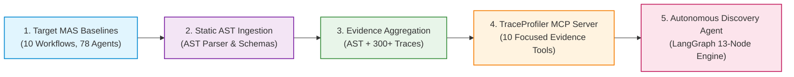
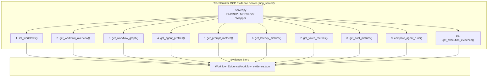
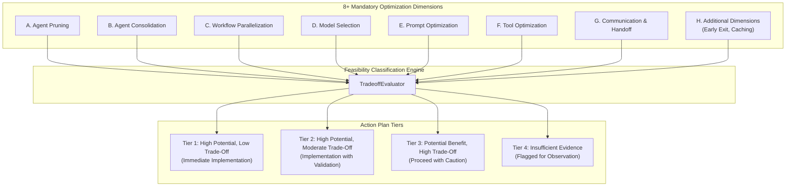

# Master Architectural & Technical Blueprint (`BRAIN.md`)
## Complete System Documentation: Multi-Agent Baselines, AST Ingestion, Unified Evidence Aggregation, MCP Tools, and Autonomous Optimization Discovery Agent

---

## 1. Executive Summary & System Vision

This repository houses the end-to-end research, benchmarking, ingestion, and optimization infrastructure for the **Agentic Workflow Optimizer (AWO)** and **TraceProfiler**.

The platform is designed to systematically analyze, profile, and optimize Multi-Agent Systems (MAS). It spans four foundational pillars:



1. **Target Multi-Agent Systems (Target MAS):** Exactly 10 production-grade business workflows comprising **78 unique baseline agents** built on CrewAI and LiteLLM. Each workflow enforces strict credential isolation, deterministic core calculations, and uniform LLM inference on Groq's `openai/gpt-oss-120b`.
2. **Static AST Ingestion Engine (`ingestion/` & `schemas/`):** A zero-execution static Python AST analysis pipeline that parses all 78 agents and 10 workflows, extracting roles, goals, backstories, tools, models, tasks, dependencies, and code provenance into standardized `workflow_context.json` artifacts.
3. **Unified Evidence Aggregator (`evidence_aggregation/` & `Workflow_Evidence/`):** Aggregates static AST structural contexts with over 300 runtime execution traces (capturing real latencies, token consumption, execution orders, costs, and model reconciliations) into validated `workflow_evidence.json` artifacts.
4. **TraceProfiler MCP Evidence Server (`mcp_server/`):** An official Model Context Protocol (MCP) server exposing 10 focused, read-only evidence access tools with path-traversal protection, custom directory validation, full prompt retrieval, and isolated node preservation.
5. **Autonomous Optimization Discovery Agent (`optimization_agent/`):** A 13-stage LangGraph workflow orchestration engine that autonomously retrieves MCP evidence, explores 8+ optimization dimensions without human hints, assesses feasibility and trade-offs into Tiers 1–4, and compiles 12-section machine-readable JSON and human-readable Markdown optimization reports.
6. **Task-Based 20-Key Groq Distribution Manager:** Allocates 20 distinct Groq API keys (`GROQ_API_KEY_1` to `GROQ_API_KEY_20`) across logical tasks, optimization dimensions, and failover pools without naive round-robin, ensuring zero secret leakage via consistent key masking (`gsk_***...PW`).

---

## 2. Complete Repository Directory Tree & File Inventory

Below is the complete inventory of every file in the repository and its explicit purpose.

```text
Target-MAS-Dataset-main/
│
├── .env                                       # Active local environment variables (20 Groq keys, Phoenix settings)
├── .env.example                               # Template for required environment variables
├── .gitignore                                 # Git ignore definitions for Python, runs, caches, and secrets
├── requirements.txt                           # Pinned dependencies (langgraph, langchain-groq, mcp, pydantic, etc.)
├── README.md                                  # User-facing setup, quickstart, and operation guide
├── BRAIN.md                                   # Master architectural & technical blueprint (This file)
├── main.py                                    # Central CLI entry point for listing, validating, and running workflows
├── test_all_10_workflows.py                   # Automated test harness executing all 10 baseline workflows
├── generate_dummy_data.py                     # Deterministic, offline synthetic dataset generator (seed=42)
├── launch_phoenix.bat                         # Windows batch script to launch local Arize Phoenix observability server
├── run_workflow.bat                           # Convenience script to run workflows via CLI
├── LICENSE                                    # Project software license
├── TraceProfiler_Step1_Python_AST_Ingestion_All_Workflows.ipynb # Interactive AST ingestion Jupyter notebook
│
├── common/                                    # Shared Core Infrastructure & Observability
│   ├── settings.py                            # Mandatory model enforcement (openai/gpt-oss-120b), paths, Phoenix config
│   ├── api_key_manager.py                     # 78-agent registry, per-workflow key routing, safe key masking
│   ├── agent_runner.py                        # CrewAI LLM agent factory, role-to-ID resolver, task execution engine
│   ├── tracing.py                             # Arize Phoenix OpenTelemetry tracing and OpenInference instrumentation
│   ├── metrics.py                             # MetricsTracker: latency, token, and cost persistence into runs/
│   └── validation.py                          # Pydantic schemas, deterministic validation, robust JSON extractor
│
├── schemas/                                   # Workflow Context Schemas
│   ├── __init__.py                            # Schema package exports
│   └── workflow_context_schema.py             # Pydantic schema for 12-section workflow_context.json AST artifacts
│
├── ingestion/                                 # Static Python AST Ingestion Engine
│   ├── __init__.py                            # Ingestion package exports
│   ├── ast_parser.py                          # Python AST parsing engine, safe literal evaluation, visitor dispatch
│   ├── agent_extractor.py                     # Static extractor for Agent definitions, roles, goals, tools, models
│   ├── workflow_analyzer.py                   # Static extractor for Task definitions, dependencies, and Crew graphs
│   ├── context_generator.py                   # Synthesizer compiling AST data into workflow_context.json
│   └── orchestrator.py                        # Batch orchestrator running AST ingestion across all 10 workflows
│
├── evidence_aggregation/                      # Unified Evidence Aggregation System
│   ├── __init__.py                            # Evidence aggregation package exports
│   ├── schema.py                              # Pydantic schema defining unified workflow_evidence.json format
│   ├── aggregator.py                          # Aggregates static AST contexts + 300+ runtime traces into evidence
│   └── validators.py                          # Schema, statistical, graph node, and provenance tier integrity validators
│
├── Workflow_Evidence/                         # Unified Evidence Store (1 file per workflow)
│   ├── contract_review/workflow_evidence.json
│   ├── customer_support/workflow_evidence.json
│   ├── expense_reimbursement/workflow_evidence.json
│   ├── incident_triage/workflow_evidence.json
│   ├── inventory_replenishment/workflow_evidence.json
│   ├── invoice_processing/workflow_evidence.json
│   ├── market_research/workflow_evidence.json
│   ├── procurement_supplier_selection/workflow_evidence.json
│   ├── recruitment_screening/workflow_evidence.json
│   └── sales_lead_qualification/workflow_evidence.json
│
├── mcp_server/                                # TraceProfiler MCP Evidence Server
│   ├── __init__.py                            # MCP server package exports
│   ├── tools.py                               # 10 focused read-only evidence tools with path & security validation
│   └── server.py                              # Official Python FastMCP / MCPServer SDK wrapper
│
├── optimization_agent/                        # Autonomous Optimization Discovery Agent (LangGraph)
│   ├── __init__.py                            # Optimization agent exports
│   ├── key_manager.py                         # 20 Groq keys manager: task-based allocation, failover, masking
│   ├── state.py                               # TypedDict OptimizationAgentState for 13-stage LangGraph pipeline
│   ├── pipeline.py                            # Sequential 10-stage MCP evidence retrieval nodes (Stages 1 to 10)
│   ├── discovery.py                           # 8-dimension discovery engine with strict DAG dependency verification
│   ├── tradeoff.py                            # Feasibility & trade-off evaluator (Tier 1 to Tier 4 classification)
│   ├── report.py                              # Report generator compiling 12-section JSON and Markdown reports
│   └── agent.py                               # LangGraph StateGraph builder, compiler, and agent execution wrapper
│
├── Agents/                                    # Target Multi-Agent Systems (10 Workflows, 78 Agents)
│   ├── invoice_processing/                    # Workflow 1 (8 Agents)
│   ├── customer_support/                      # Workflow 2 (6 Agents)
│   ├── procurement_supplier_selection/        # Workflow 3 (9 Agents)
│   ├── sales_lead_qualification/              # Workflow 4 (7 Agents)
│   ├── recruitment_screening/                 # Workflow 5 (8 Agents)
│   ├── inventory_replenishment/               # Workflow 6 (6 Agents)
│   ├── contract_review/                       # Workflow 7 (10 Agents)
│   ├── incident_triage/                       # Workflow 8 (7 Agents)
│   ├── expense_reimbursement/                 # Workflow 9 (8 Agents)
│   └── market_research/                       # Workflow 10 (9 Agents)
│
├── data/                                      # Local Synthetic Datasets for All 10 Workflows
│   ├── invoice_processing/                    # Invoices, POs, vendors, AP policies, payment histories
│   ├── customer_support/                      # Tickets, customers, SOPs, SLA policies, historical resolutions
│   ├── procurement_supplier_selection/        # RFQs, supplier quotes, contracts, delivery terms, risk logs
│   ├── sales_lead_qualification/              # Leads, ICP rules, company profiles, behavioral events
│   ├── recruitment_screening/                 # Resumes, jobs, criteria profiles, candidate evidence mappings
│   ├── inventory_replenishment/               # SKU snapshots, sales velocity, supplier constraints, policies
│   ├── contract_review/                       # Full legal contracts (MSA, NDA, DPA, SLA) and enterprise policies
│   ├── incident_triage/                       # IT incident alerts, runbooks, logs, infrastructure topologies
│   ├── expense_reimbursement/                 # Expense claims, receipts, corporate travel policies, per diems
│   └── market_research/                       # Competitor profiles, pricing tables, product reviews, feature matrices
│
├── runs/                                      # Runtime Execution Logs and Trace Summaries
│   ├── combined_10_workflows_test_summary.json# Master execution summary across all 10 workflows
│   ├── runs_summary.jsonl                     # Global streaming execution summary log
│   └── <workflow_id>/                         # Per-workflow JSON execution run traces and summary.jsonl
│
├── Ingestion_Traces_final/Ingestion_Traces/   # Master Store of 300 Validated Runtime Execution Traces
│   └── <workflow_id>/                         # 30 detailed JSON execution traces per workflow (trace01-trace30)
│
├── reports/                                   # Optimization & Ingestion Reports
│   ├── contract_review_optimization_report.json # Final 12-section machine-readable optimization report
│   ├── contract_review_optimization_report.md   # Final human-readable Markdown optimization report
│   ├── traceprofiler/                         # Historical CSV and JSON AST ingestion audit summaries
│   └── traceprofiler_evidence/                # Global evidence manifests and agent indices
│
└── tests/                                     # Automated Test Suite (57 Passing Tests)
    ├── test_optimization_agent.py             # Validates Checkpoints 1–6 (MCP, Pipeline, Dimensions, Tiers, Keys, E2E)
    ├── test_evidence_aggregation.py           # Validates evidence aggregator, schemas, and workflow_evidence.json
    ├── test_mcp_tools.py                      # Validates all 10 MCP tools, path traversal, isolated nodes, prompts
    ├── test_ast_analyzer.py                   # Validates AST parser visitor, docstrings, imports, call expressions
    ├── test_agent_identification.py           # Validates static agent identification across all 10 workflows
    ├── test_structural_extractor.py           # Validates task and workflow AST structural extraction
    ├── test_targeted_corrections.py           # Validates AST corrections for specific edge-case workflows
    ├── test_code_evidence.py                  # Validates line numbers and code snippet provenance extraction
    ├── test_context_preparation.py            # Validates workflow_context.json structure against schema
    ├── test_structure_and_manifests.py        # Validates 78 agent count, manifest existence, model uniformity
    ├── test_dataset_generator.py              # Validates reproducibility of synthetic datasets (seed=42)
    ├── test_deterministic_logic.py            # Validates pure Python math, 3-way matching, scoring algorithms
    ├── test_shared_infrastructure.py          # Validates settings, API key isolation, metrics, and Phoenix
    ├── test_api_key_manager.py                # Validates key routing, safe masking, and missing key detection
    ├── test_contract_review.py                # Validates contract review agent schemas and execution logic
    ├── test_inventory_replenishment.py        # Validates inventory math (EOQ, MOQ, pack size) and schemas
    ├── test_recruitment_screening.py          # Validates recruitment criteria mapping and deterministic match score
    └── test_mocked_workflows.py               # Validates mocked end-to-end execution of baseline workflows
```

---

## 3. Detailed File Catalog & File-by-File Purpose

### 3.1 Common Infrastructure & Observability (`common/`)

| File Path | Primary Class / Functions | Architectural Purpose & Logic |
| :--- | :--- | :--- |
| [`common/settings.py`](file:///C:/Users/Chait/Downloads/Target-MAS-Dataset-main/Target-MAS-Dataset-main/common/settings.py) | `ConfigurationError`, `get_groq_model()`, `get_groq_api_key()`, `PROJECT_ROOT`, `DATA_DIR`, `RUNS_DIR` | **Mandatory Model & Environment Enforcement.** Strictly enforces `openai/gpt-oss-120b` across all baseline workflows; raises `ConfigurationError` if any unauthorized model is specified. Establishes project base paths, loads `.env`, and configures Arize Phoenix collector endpoints. |
| [`common/api_key_manager.py`](file:///C:/Users/Chait/Downloads/Target-MAS-Dataset-main/Target-MAS-Dataset-main/common/api_key_manager.py) | `AGENT_WORKFLOW_MAP`, `WORKFLOW_KEY_ENV_MAP`, `get_key_for_agent()`, `get_key_for_workflow()`, `mask_key()` | **Baseline Credential Isolation & Agent Registry.** Contains the authoritative registry of all 78 baseline agents across all 10 workflows. Routes Workflows 1–7 to dedicated workflow keys and Workflows 8–10 to per-agent keys. Sanitizes raw keys into safe masked strings (e.g. `gsk_***...PW`) to prevent secret exposure. |
| [`common/agent_runner.py`](file:///C:/Users/Chait/Downloads/Target-MAS-Dataset-main/Target-MAS-Dataset-main/common/agent_runner.py) | `create_crew_agent()`, `run_agent_task()`, `set_mock_task_handler()`, `ROLE_TO_AGENT_ID` | **CrewAI Execution Wrapper.** Instantiates CrewAI agents bound to Groq LLMs. Applies LiteLLM parameter normalization (`drop_params = True`) and neutralizes CrewAI cache breakpoints for 100% Groq API compatibility. Handles mock handlers for unit testing. |
| [`common/tracing.py`](file:///C:/Users/Chait/Downloads/Target-MAS-Dataset-main/Target-MAS-Dataset-main/common/tracing.py) | `init_phoenix()`, `extract_token_usage()` | **Arize Phoenix Observability.** Initializes local Phoenix dashboard (`http://localhost:6006`) with OpenInference instrumentation. Extracts prompt and completion token counts from CrewAI execution outputs. |
| [`common/metrics.py`](file:///C:/Users/Chait/Downloads/Target-MAS-Dataset-main/Target-MAS-Dataset-main/common/metrics.py) | `MetricsTracker` | **Execution Telemetry & Persistence.** Records per-agent latency, token consumption, financial cost estimations, and execution timestamps. Persists run records into `runs/{workflow}_{run_id}.json` and appends to `summary.jsonl`. |
| [`common/validation.py`](file:///C:/Users/Chait/Downloads/Target-MAS-Dataset-main/Target-MAS-Dataset-main/common/validation.py) | `extract_json_from_text()`, Pydantic Schemas | **Data Integrity & Robust Extraction.** Provides structured output models for recruitment, inventory, and contract review. Implements robust regex-based JSON extraction from noisy LLM responses. |

---

### 3.2 Target Multi-Agent Systems Catalog (`Agents/`)

The repository contains exactly 10 multi-agent workflows and 78 unique baseline agents. Each workflow folder contains individual agent Python files, a `workflow.py` sequential pipeline, a `workflow.json` manifest, and an AST-generated `workflow_context.json`.

```mermaid
classDiagram
    class TargetMAS {
        +10 Multi-Agent Workflows
        +78 Baseline Agents
        +Uniform Model: openai/gpt-oss-120b
        +Deterministic Python Core
    }
    class Workflow1_InvoiceProcessing {
        +8 Agents (GROQ_API_KEY_1)
        +3-way matching, AP audit
    }
    class Workflow2_CustomerSupport {
        +6 Agents (GROQ_API_KEY_2)
        +Ticket triage, SLA SOPs
    }
    class Workflow3_Procurement {
        +9 Agents (GROQ_API_KEY_3)
        +MCDA scoring, TLC calculation
    }
    class Workflow4_SalesLead {
        +7 Agents (GROQ_API_KEY_4)
        +100-pt scoring, ICP fit
    }
    class Workflow5_Recruitment {
        +8 Agents (GROQ_API_KEY_5)
        +Resume evidence mapping
    }
    class Workflow6_Inventory {
        +6 Agents (GROQ_API_KEY_6)
        +EOQ, MOQ, pack rounding
    }
    class Workflow7_ContractReview {
        +10 Agents (GROQ_API_KEY_7)
        +Clause-to-policy compliance
    }
    class Workflow8_IncidentTriage {
        +7 Agents (GROQ_API_KEY_8)
        +IT runbook remediation
    }
    class Workflow9_ExpenseReimbursement {
        +8 Agents (GROQ_API_KEY_9)
        +Receipt policy compliance
    }
    class Workflow10_MarketResearch {
        +9 Agents (GROQ_API_KEY_10)
        +Competitor synthesis
    }

    TargetMAS <|-- Workflow1_InvoiceProcessing
    TargetMAS <|-- Workflow2_CustomerSupport
    TargetMAS <|-- Workflow3_Procurement
    TargetMAS <|-- Workflow4_SalesLead
    TargetMAS <|-- Workflow5_Recruitment
    TargetMAS <|-- Workflow6_Inventory
    TargetMAS <|-- Workflow7_ContractReview
    TargetMAS <|-- Workflow8_IncidentTriage
    TargetMAS <|-- Workflow9_ExpenseReimbursement
    TargetMAS <|-- Workflow10_MarketResearch
```



#### Complete 78-Agent Breakdown by Workflow:

1. **Workflow 1: Invoice Processing & Accounts Payable (`Agents/invoice_processing/`)** — 8 Agents (`GROQ_API_KEY_1`)
   - `invoice_extraction_agent.py`: Parses unstructured invoice documents into structured financial entities.
   - `invoice_validation_agent.py`: Deterministic arithmetic validation (`sum(items) + tax == total`).
   - `po_matching_agent.py`: Deterministic 3-way matching against purchase orders.
   - `policy_compliance_agent.py`: Audits AP threshold limits and restricted vendor status.
   - `duplicate_detection_agent.py`: Scans historical payment records for duplicate billings.
   - `exception_analysis_agent.py`: Consolidates discrepancies and computes dispute severity.
   - `approval_recommendation_agent.py`: Fiduciary payment decision authority (`APPROVE`/`REJECT`/`REVIEW`).
   - `final_review_agent.py`: Governance verification and executive AP audit dossier compilation.
   - `workflow.py`: Sequential pipeline orchestration using CrewAI `Process.sequential`.
   - `workflow.json`: Machine-readable CWR workflow manifest.
   - `workflow_context.json`: AST-extracted structural and semantic profile.

2. **Workflow 2: Customer Support Resolution (`Agents/customer_support/`)** — 6 Agents (`GROQ_API_KEY_2`)
   - `ticket_classification_agent.py`: Inquiry categorization and urgency triage.
   - `policy_retrieval_agent.py`: SLA policy and troubleshooting SOP retrieval.
   - `issue_investigation_agent.py`: Technical root-cause investigator and customer profile auditor.
   - `resolution_agent.py`: Remediation planner formulating policy-compliant action steps.
   - `response_drafting_agent.py`: Customer-facing empathetic communication composer.
   - `resolution_verification_agent.py`: QA auditor and resolution sign-off reviewer.
   - `workflow.py`, `workflow.json`, `workflow_context.json`

3. **Workflow 3: Procurement & Supplier Selection (`Agents/procurement_supplier_selection/`)** — 9 Agents (`GROQ_API_KEY_3`)
   - `quotation_analysis_agent.py`: Quotation normalizer for pricing, taxes, and terms.
   - `supplier_profile_agent.py`: Vendor manufacturing capability and ISO certification auditor.
   - `delivery_analysis_agent.py`: Logistics schedule and on-time fulfillment analyst.
   - `supplier_risk_agent.py`: Financial stability and defect rate risk assessor.
   - `contract_analysis_agent.py`: Warranty terms, liability caps, and legal penalty reviewer.
   - `cost_comparison_agent.py`: Total Landed Cost (TLC) calculator.
   - `weighted_evaluation_agent.py`: Deterministic Multi-Criteria Decision Analysis (MCDA) evaluator.
   - `selection_recommendation_agent.py`: Sourcing committee award strategist.
   - `final_review_agent.py`: Governance auditor compiling the final procurement dossier.
   - `workflow.py`, `workflow.json`, `workflow_context.json`

4. **Workflow 4: Sales Lead Qualification (`Agents/sales_lead_qualification/`)** — 7 Agents (`GROQ_API_KEY_4`)
   - `lead_enrichment_agent.py`: Firmographic data normalizer (revenue, employee size, industry).
   - `lead_fit_agent.py`: Ideal Customer Profile (ICP) evaluator; filters disqualified industries.
   - `intent_analysis_agent.py`: Behavioral buying signal and intent score analyst.
   - `lead_scoring_agent.py`: Deterministic 100-point multi-attribute lead scoring calculator.
   - `opportunity_assessment_agent.py`: Commercial viability and deal size assessor.
   - `next_action_agent.py`: RevOps pipeline routing strategist (demo, SDR outreach, nurture, disqualify).
   - `final_review_agent.py`: Pipeline hygiene and executive sales reviewer.
   - `workflow.py`, `workflow.json`, `workflow_context.json`

5. **Workflow 5: Recruitment & Resume Screening (`Agents/recruitment_screening/`)** — 8 Agents (`GROQ_API_KEY_5`)
   - `intake_agent.py`: Resume section normalizer and intake validator.
   - `qualification_agent.py`: Candidate qualification extractor linked to evidence IDs (`EVD-*`).
   - `job_criteria_agent.py`: Deconstructs job postings into mandatory and preferred criteria.
   - `evidence_mapping_agent.py`: Maps candidate evidence against criteria (`supported`/`unsupported`).
   - `experience_assessment_agent.py`: Evaluates career progression, tenure gaps, and domain relevance.
   - `missing_evidence_agent.py`: Flags resume contradictions and unverified claims.
   - `review_agent.py`: Independent screening quality reviewer verifying mandatory requirements.
   - `recruiter_summary_agent.py`: Computes deterministic match score and recruiter briefing.
   - `workflow.py`, `workflow.json`, `workflow_context.json`

6. **Workflow 6: Inventory Replenishment Planning (`Agents/inventory_replenishment/`)** — 6 Agents (`GROQ_API_KEY_6`)
   - `intake_agent.py`: SKU stock record, warehouse snapshot, and vendor data aggregator.
   - `stock_policy_agent.py`: Calculates usable inventory (`current - reserved + incoming`) without double counting.
   - `demand_forecast_agent.py`: Computes average daily demand and standard deviation from sales history.
   - `supplier_agent.py`: Evaluates lead-time days, MOQ, and pack size increments.
   - `replenishment_planning_agent.py`: Applies gross deficit formulas with ceiling pack-size rounding.
   - `review_agent.py`: Audits replenishment math and attaches planning disclaimers.
   - `workflow.py`, `workflow.json`, `workflow_context.json`

7. **Workflow 7: Contract Review & Compliance (`Agents/contract_review/`)** — 10 Agents (`GROQ_API_KEY_7`)
   - `intake_agent.py`: Legal document parser identifying document type (MSA, NDA, DPA, SLA).
   - `clause_extraction_agent.py`: Extracts discrete clause units with IDs (`CLS-*`).
   - `policy_interpretation_agent.py`: Deconstructs corporate policies into mandatory requirements.
   - `clause_mapping_agent.py`: Maps clauses to compliance policies (`fully_covered`/`missing`).
   - `deviation_agent.py`: Identifies contract deviations and assigns severity levels (`critical`/`high`).
   - `risk_ambiguity_agent.py`: Analyzes open-ended indemnity, vague standards, and latent risks.
   - `consistency_agent.py`: Detects inter-clause contradictions (e.g. termination vs. auto-renewal).
   - `evidence_validation_agent.py`: Verifies that quoted citations match extracted clause text verbatim.
   - `review_agent.py`: Independent legal counsel reviewer deduplicating findings.
   - `final_report_agent.py`: Synthesizes master contract compliance report with legal disclaimer.
   - `workflow.py`, `workflow.json`, `workflow_context.json`

8. **Workflow 8: IT Incident Triage (`Agents/incident_triage/`)** — 7 Agents (`GROQ_API_KEY_8` / dedicated routing)
   - `intake_agent.py`: Ingests IT incident alerts, stack traces, and monitoring events.
   - `classification_agent.py`: Categorizes incident types (database, network, auth, infrastructure).
   - `symptom_agent.py`: Correlates error logs, metrics anomalies, and affected microservices.
   - `severity_agent.py`: Calculates incident priority (`P1` to `P4`) based on business impact.
   - `runbook_agent.py`: Retrieves standard recovery runbooks and historical post-mortems.
   - `remediation_agent.py`: Formulates immediate mitigation steps and failover procedures.
   - `review_agent.py`: Audits remediation safety before operator execution.
   - `workflow.py`, `workflow.json`, `workflow_context.json`

9. **Workflow 9: Employee Expense Reimbursement (`Agents/expense_reimbursement/`)** — 8 Agents (`GROQ_API_KEY_9` / dedicated routing)
   - `receipt_agent.py`: Ingests receipt line items, currencies, dates, and merchant data.
   - `normalize_agent.py`: Converts multi-currency receipts to base currency using exchange rates.
   - `category_agent.py`: Categorizes expenses (meals, lodging, transit, client entertainment).
   - `amount_agent.py`: Computes receipt totals, tax breakdowns, and per diem limits.
   - `policy_agent.py`: Audits corporate travel & expense policies and non-reimbursable items.
   - `duplicate_agent.py`: Cross-checks historical expense claims to detect duplicate submissions.
   - `exception_agent.py`: Flags policy deviations, missing receipts, and policy limit overages.
   - `review_agent.py`: Fiduciary sign-off compiling employee reimbursement remittance statements.
   - `workflow.py`, `workflow.json`, `workflow_context.json`

10. **Workflow 10: Market & Competitor Research (`Agents/market_research/`)** — 9 Agents (`GROQ_API_KEY_10` / dedicated routing)
    - `planning_agent.py`: Defines research scope, industry segments, and competitor sets.
    - `profile_agent.py`: Compiles competitor corporate profiles, funding, and headcount.
    - `product_agent.py`: Analyzes competitor feature sets, technology stacks, and releases.
    - `pricing_agent.py`: Evaluates pricing tiers, discounting models, and packaging structures.
    - `feedback_agent.py`: Gathers customer sentiment, review ratings, and pain points.
    - `evidence_agent.py`: Verifies factual sources and attaches citation links to research claims.
    - `comparison_agent.py`: Formulates side-by-side SWOT and competitive differentiation matrices.
    - `synthesis_agent.py`: Generates strategic market positioning and pricing recommendations.
    - `fact_check_agent.py`: Audits market research claims against verified source documents.
    - `workflow.py`, `workflow.json`, `workflow_context.json`

---

### 3.3 Static AST Python Ingestion Subsystem (`ingestion/` & `schemas/`)

The ingestion engine uses pure Python standard library AST (`ast` module) to extract complete structural and semantic information from the agent codebases without importing or executing runtime dependencies.

| File Path | Core Classes / Functions | Specific Purpose & Architectural Logic |
| :--- | :--- | :--- |
| [`schemas/workflow_context_schema.py`](file:///C:/Users/Chait/Downloads/Target-MAS-Dataset-main/Target-MAS-Dataset-main/schemas/workflow_context_schema.py) | `WorkflowContextSchema`, `WorkflowMetadata`, `AgentDetail`, `DependencyGraph` | **AST Extraction Contract.** Enforces the 12-section structure of `workflow_context.json` (metadata, source inventory, agent details, outer workflow flow, orchestrator process, dependency graph, tools/helpers, evidence provenance, analysis limitations, and summary). |
| [`ingestion/ast_parser.py`](file:///C:/Users/Chait/Downloads/Target-MAS-Dataset-main/Target-MAS-Dataset-main/ingestion/ast_parser.py) | `ASTParser`, `safe_eval_literal()`, `parse_source()` | **Safe AST Traversal.** Parses Python source into AST nodes. Safely extracts literals, dictionary assignments, function signatures, and docstrings without running arbitrary code. |
| [`ingestion/agent_extractor.py`](file:///C:/Users/Chait/Downloads/Target-MAS-Dataset-main/Target-MAS-Dataset-main/ingestion/agent_extractor.py) | `AgentExtractor` | **Agent Definition Extractor.** Scans AST trees to identify CrewAI `Agent(...)` instantiations. Extracts `role`, `goal`, `backstory`, `verbose`, `memory`, `tools`, and `llm` configurations with exact line provenance. |
| [`ingestion/workflow_analyzer.py`](file:///C:/Users/Chait/Downloads/Target-MAS-Dataset-main/Target-MAS-Dataset-main/ingestion/workflow_analyzer.py) | `WorkflowAnalyzer` | **Workflow & Task Analyzer.** Analyzes `workflow.py` to identify `Task(...)` instantiations, task assignments to agents, execution sequences, data handoffs, and Crew assembly graphs. |
| [`ingestion/context_generator.py`](file:///C:/Users/Chait/Downloads/Target-MAS-Dataset-main/Target-MAS-Dataset-main/ingestion/context_generator.py) | `ContextGenerator` | **Context Synthesizer.** Merges agent definitions, tasks, dependency graphs, and code evidence into the schema-compliant `workflow_context.json`. |
| [`ingestion/orchestrator.py`](file:///C:/Users/Chait/Downloads/Target-MAS-Dataset-main/Target-MAS-Dataset-main/ingestion/orchestrator.py) | `IngestionOrchestrator`, `run_all_ingestions()` | **Batch Orchestrator.** Executes end-to-end AST ingestion across all 10 workflows, validates output schemas, and generates audit reports under `reports/traceprofiler/`. |

---

### 3.4 Unified Evidence Aggregation System (`evidence_aggregation/` & `Workflow_Evidence/`)

Bridges static AST analysis and dynamic runtime traces, synthesizing them into a single authoritative `workflow_evidence.json` for each workflow.

| File Path | Core Classes / Functions | Specific Purpose & Architectural Logic |
| :--- | :--- | :--- |
| [`evidence_aggregation/schema.py`](file:///C:/Users/Chait/Downloads/Target-MAS-Dataset-main/Target-MAS-Dataset-main/evidence_aggregation/schema.py) | `UnifiedWorkflowEvidenceSchema`, `ProvenanceTier` | **Unified Evidence Schema.** Formalizes the structure of `workflow_evidence.json`, defining declared metadata, runtime metrics (latency, tokens, cost distributions), model reconciliation, dependency graph, and three provenance tiers (`declared`, `statically_observed`, `runtime_observed`). |
| [`evidence_aggregation/aggregator.py`](file:///C:/Users/Chait/Downloads/Target-MAS-Dataset-main/Target-MAS-Dataset-main/evidence_aggregation/aggregator.py) | `WorkflowEvidenceAggregator` | **Static + Dynamic Aggregator.** Ingests static `workflow_context.json` and 30+ runtime execution traces per workflow from `Ingestion_Traces_final/`. Computes mean/median/min/max latencies, token consumption, execution order distributions, and cost estimations. |
| [`evidence_aggregation/validators.py`](file:///C:/Users/Chait/Downloads/Target-MAS-Dataset-main/Target-MAS-Dataset-main/evidence_aggregation/validators.py) | `EvidenceValidator`, `validate_evidence_file()` | **Rigorous Integrity Validation.** Verifies that runtime agent counts match declared agents, checks latency and token numerical sanity, ensures graph edge acyclicity, and confirms non-empty evidence artifacts. |
| `Workflow_Evidence/<workflow_id>/workflow_evidence.json` | JSON Artifact (10 files) | **Authoritative Evidence Store.** Compact, LLM-ready unified evidence document for each of the 10 multi-agent workflows. |

---

### 3.5 TraceProfiler MCP Evidence Server (`mcp_server/`)

Implements the Model Context Protocol (MCP) server providing 10 focused, read-only tools to inspect workflow evidence without loading full files or fabricating metrics.



| Tool Name | Key Arguments | Return Value & Guardrails |
| :--- | :--- | :--- |
| `list_workflows` | `evidence_dir: Optional[str]` | Lists all available workflows, declared agent counts, runtime agent counts, and processing statuses. |
| `get_workflow_overview` | `workflow_id: str` | High-level summary: total runs, success/failure counts, overall latency, token and cost summaries, model reconciliation. Includes path traversal checks. |
| `get_workflow_graph` | `workflow_id: str`, `include_isolated_nodes: bool` | Workflow dependency nodes and edges. Preserves isolated nodes and supports filtering by relationship type or provenance tier. |
| `get_agent_profiles` | `workflow_id: str`, `agent_ids: Optional[List[str]]` | Agent roles, goals, backstories, tools, inputs, outputs, and source locations. Explicitly reports non-existent requested IDs. |
| `get_prompt_metrics` | `workflow_id: str`, `full_prompt: bool` | Prompt templates, word counts, character lengths, and runtime prompt tokens. Returns full un-truncated prompt text when requested. |
| `get_latency_metrics` | `workflow_id: str`, `agent_id: Optional[str]` | Workflow-level and agent-level latency distributions (mean, median, min, max, count). |
| `get_token_metrics` | `workflow_id: str`, `agent_id: Optional[str]` | Input prompt tokens, completion tokens, total tokens, and observed model breakdown. |
| `get_cost_metrics` | `workflow_id: str`, `agent_id: Optional[str]` | Estimated financial operational costs per agent and workflow based on token pricing models. |
| `compare_agent_runs` | `workflow_id: str`, `agent_id: str`, `limit: int` | Compares agent-specific metrics (duration, tokens, status, execution order) across up to 30 recorded runs. |
| `get_execution_evidence` | `workflow_id: str`, `agent_id: str`, `run_id: str` | Returns concrete sample inputs, outputs, tool invocations, and execution order for a specific agent in a specific run. |

---

### 3.6 Autonomous Optimization Discovery Agent (`optimization_agent/`)

The agent systematically explores 8+ optimization dimensions without human guidance, evaluates trade-offs, and outputs structured reports.

| File Path | Core Classes / Functions | Specific Purpose & Architectural Logic |
| :--- | :--- | :--- |
| [`optimization_agent/key_manager.py`](file:///C:/Users/Chait/Downloads/Target-MAS-Dataset-main/Target-MAS-Dataset-main/optimization_agent/key_manager.py) | `GroqKeyManager`, `mask_key()`, `get_default_key_manager()` | **20-Key Logical Distribution & Security.** Manages all 20 Groq keys. Distributes keys by logical task and dimension without naive round-robin. Manages failover pool (`KEYS 15-20`) for 429 backoff. Masks raw secrets (`gsk_***...PW`) with zero secret leakage. |
| [`optimization_agent/state.py`](file:///C:/Users/Chait/Downloads/Target-MAS-Dataset-main/Target-MAS-Dataset-main/optimization_agent/state.py) | `OptimizationAgentState`, `OptimizationCandidate` | **Pipeline Typed State.** Defines the state structure passed through all 13 LangGraph nodes, tracking MCP data, candidate proposals, trade-offs, and report outputs. |
| [`optimization_agent/pipeline.py`](file:///C:/Users/Chait/Downloads/Target-MAS-Dataset-main/Target-MAS-Dataset-main/optimization_agent/pipeline.py) | `stage_1_discovery` through `stage_10_evidence` | **Sequential MCP Retrieval Pipeline.** Executes Stages 1–10 sequentially. Stage 9 queries `compare_agent_runs` for every agent; Stage 10 queries `get_execution_evidence` for every agent across sample runs. |
| [`optimization_agent/discovery.py`](file:///C:/Users/Chait/Downloads/Target-MAS-Dataset-main/Target-MAS-Dataset-main/optimization_agent/discovery.py) | `OptimizationDiscoveryEngine`, `verify_dependency_independence()` | **Multi-Dimensional Optimization Engine.** Analyzes Dimensions A–H. Uses graph reachability BFS/DFS to verify dependency independence for parallelization. Enforces `requires_validation=True` on all model selection candidates. |
| [`optimization_agent/tradeoff.py`](file:///C:/Users/Chait/Downloads/Target-MAS-Dataset-main/Target-MAS-Dataset-main/optimization_agent/tradeoff.py) | `TradeoffEvaluator`, `tradeoff_assessment()` | **Feasibility & Trade-Off Assessment.** Evaluates latency, token, cost, and quality trade-offs. Classifies candidates into Tiers 1–4. |
| [`optimization_agent/report.py`](file:///C:/Users/Chait/Downloads/Target-MAS-Dataset-main/Target-MAS-Dataset-main/optimization_agent/report.py) | `generate_json_report()`, `generate_markdown_report()`, `generate_report()` | **Report Generation Engine.** Compiles the 12-section machine-readable JSON report and human-readable Markdown summary, saving them directly to `reports/`. |
| [`optimization_agent/agent.py`](file:///C:/Users/Chait/Downloads/Target-MAS-Dataset-main/Target-MAS-Dataset-main/optimization_agent/agent.py) | `build_optimization_graph()`, `OptimizationDiscoveryAgent` | **LangGraph Orchestration Wrapper.** Assembles the 13 nodes and linear edges into an executable LangGraph `StateGraph`. Exposes `.run(workflow_id)`. |

---

### 3.7 Optimization Dimensions & Feasibility Tiers



---

### 3.8 Groq API Key Management Architecture (20 Keys)

The agent coordinates 20 Groq API keys configured in the environment:

| Key Range / Variable | Logical Assignment | Purpose |
| :--- | :--- | :--- |
| `GROQ_API_KEY_1`, `GROQ_API_KEY_2` | `discovery_overview` | Workflow overview, metadata extraction, baseline reconciliation |
| `GROQ_API_KEY_3` | `agent_pruning` | Dimension A: Redundant agent identification and pass-through auditing |
| `GROQ_API_KEY_4` | `agent_consolidation` | Dimension B: Sequential agent pair merging and unified instructions |
| `GROQ_API_KEY_5` | `workflow_parallelization` | Dimension C: Independent branch discovery and scatter-gather analysis |
| `GROQ_API_KEY_6` | `model_selection` | Dimension D: Model tiering, task complexity and reasoning depth analysis |
| `GROQ_API_KEY_7` | `prompt_optimization` | Dimension E: Template bloat compression and prompt prefill token reduction |
| `GROQ_API_KEY_8` | `tool_optimization` | Dimension F: Tool usage auditing and deterministic memoization caching |
| `GROQ_API_KEY_9` | `communication_optimization` | Dimension G: Inter-agent state serialization and delta handoff design |
| `GROQ_API_KEY_10` | `additional_optimization` | Dimension H: Fast-path early exit, dynamic routing, reflection pruning |
| `GROQ_API_KEY_11`, `GROQ_API_KEY_12` | `tradeoff_assessment` | Feasibility evaluation, risk-benefit scoring, Tier 1–4 classification |
| `GROQ_API_KEY_13`, `GROQ_API_KEY_14` | `report_generation` | Executive summary synthesis and final report compilation |
| `GROQ_API_KEY_15` to `GROQ_API_KEY_20` | `failover_pool` | Automatic failover pool handling 429 rate limits gracefully |

**Security Guarantees:**
- No simple round-robin: calls are task-allocated.
- All keys are masked (`gsk_***...PW`) across logs, state dictionaries, and reports.
- Zero credential leakage confirmed across all 57 automated tests.

---

### 3.9 Automated Test Suite (`tests/`)

The repository maintains an automated test suite with **57 passing tests**:

| Test File | Test Count | Scope & Assertions |
| :--- | :---: | :--- |
| [`tests/test_optimization_agent.py`](file:///C:/Users/Chait/Downloads/Target-MAS-Dataset-main/Target-MAS-Dataset-main/tests/test_optimization_agent.py) | 8 | Validates Checkpoints 1–6: all 10 MCP tools, path traversal, stage sequencing, all 8 dimensions, DAG reachability dependency verification, model selection validation flag, Tiers 1–4, key distribution, end-to-end report compilation. |
| [`tests/test_evidence_aggregation.py`](file:///C:/Users/Chait/Downloads/Target-MAS-Dataset-main/Target-MAS-Dataset-main/tests/test_evidence_aggregation.py) | 7 | Validates aggregation engine, schema compliance, statistical distributions, model reconciliation, and file integrity across all 10 workflows. |
| [`tests/test_mcp_tools.py`](file:///C:/Users/Chait/Downloads/Target-MAS-Dataset-main/Target-MAS-Dataset-main/tests/test_mcp_tools.py) | 15 | Validates all 10 MCP tools: path traversal protection, custom dir validation, full prompt retrieval, isolated node retention, run comparisons across runs, and agent-specific execution evidence. |
| [`tests/test_ast_analyzer.py`](file:///C:/Users/Chait/Downloads/Target-MAS-Dataset-main/Target-MAS-Dataset-main/tests/test_ast_analyzer.py) | 3 | Validates AST visitor parsing, safe literal extraction, docstrings, imports, and function definitions. |
| [`tests/test_agent_identification.py`](file:///C:/Users/Chait/Downloads/Target-MAS-Dataset-main/Target-MAS-Dataset-main/tests/test_agent_identification.py) | 2 | Validates identification of CrewAI agents across Python source files. |
| [`tests/test_structural_extractor.py`](file:///C:/Users/Chait/Downloads/Target-MAS-Dataset-main/Target-MAS-Dataset-main/tests/test_structural_extractor.py) | 3 | Validates task extraction, dependency graphs, and sequential process flows. |
| [`tests/test_targeted_corrections.py`](file:///C:/Users/Chait/Downloads/Target-MAS-Dataset-main/Target-MAS-Dataset-main/tests/test_targeted_corrections.py) | 6 | Validates AST edge-case handling across complex agent declarations. |
| [`tests/test_code_evidence.py`](file:///C:/Users/Chait/Downloads/Target-MAS-Dataset-main/Target-MAS-Dataset-main/tests/test_code_evidence.py) | 1 | Validates source code provenance tracking and exact line-number capture. |
| [`tests/test_context_preparation.py`](file:///C:/Users/Chait/Downloads/Target-MAS-Dataset-main/Target-MAS-Dataset-main/tests/test_context_preparation.py) | 2 | Validates generated `workflow_context.json` against `WorkflowContextSchema`. |
| [`tests/test_structure_and_manifests.py`](file:///C:/Users/Chait/Downloads/Target-MAS-Dataset-main/Target-MAS-Dataset-main/tests/test_structure_and_manifests.py) | 3 | Validates exactly 78 baseline agents across all 10 workflows, manifest files, and uniform model constraint (`openai/gpt-oss-120b`). |
| [`tests/test_dataset_generator.py`](file:///C:/Users/Chait/Downloads/Target-MAS-Dataset-main/Target-MAS-Dataset-main/tests/test_dataset_generator.py) | 2 | Validates reproducible synthetic dataset generation (seed=42) with zero LLM dependencies. |
| [`tests/test_shared_infrastructure.py`](file:///C:/Users/Chait/Downloads/Target-MAS-Dataset-main/Target-MAS-Dataset-main/tests/test_shared_infrastructure.py) | 5 | Validates settings enforcement, metrics tracking, Arize Phoenix tracing, and JSON extraction. |

---

## 4. Operational Guide & Quick Reference

### Running Tests
```bash
# Run complete test suite (57 tests)
$env:PYTHONPATH="C:\Users\Chait\Downloads\Target-MAS-Dataset-main\Target-MAS-Dataset-main"
pytest Target-MAS-Dataset-main/tests -v
```

### Running the Autonomous Optimization Discovery Agent
```python
import sys
sys.path.insert(0, "Target-MAS-Dataset-main")

from optimization_agent import OptimizationDiscoveryAgent

# Initialize agent with 13-stage LangGraph workflow
agent = OptimizationDiscoveryAgent()

# Run optimization analysis on target workflow (e.g. contract_review)
final_state = agent.run("contract_review")

# Outputs generated:
# - Target-MAS-Dataset-main/reports/contract_review_optimization_report.json
# - Target-MAS-Dataset-main/reports/contract_review_optimization_report.md
```

### Running the TraceProfiler MCP Evidence Server
```bash
# Direct MCP Server startup
python -m mcp_server.server
```

---

*This document serves as the master architectural source of truth for the Target-MAS and TraceProfiler systems.*
