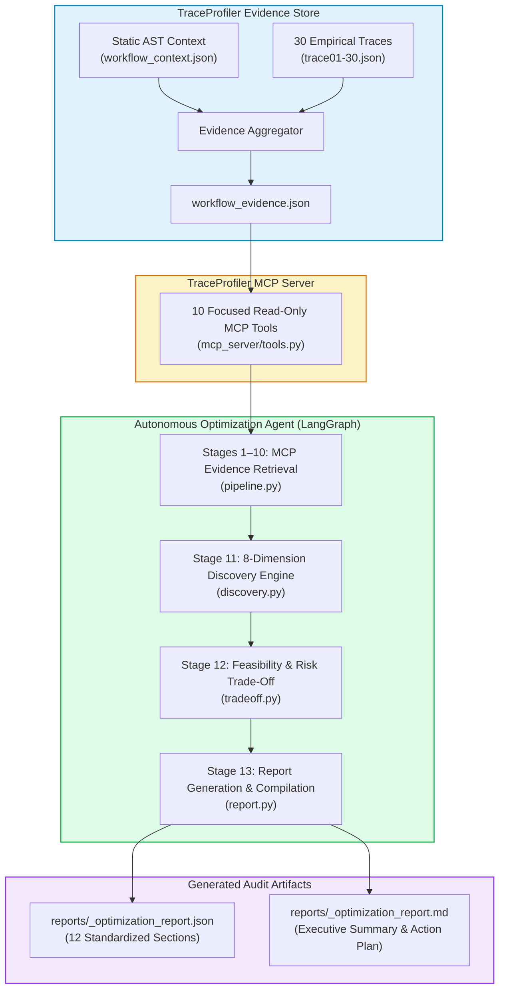
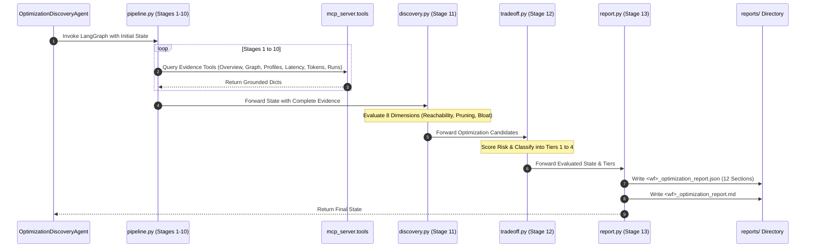

# TraceProfiler Autonomous Optimization Discovery Agent (`BRAIN.md`)
## Complete Architectural & Technical Blueprint: Input/Output Tools, 13-Stage LangGraph Engine, Heuristic Discovery Across 8 Dimensions, Trade-Off Assessment, and Report Generation

---

## 1. Executive Summary & Purpose

The **TraceProfiler Autonomous Optimization Discovery Agent** (`optimization_agent/`) is an autonomous, zero-hallucination analysis and synthesis engine. Its primary objective is to inspect production-grade Multi-Agent Systems (MAS), discover high-impact architectural and runtime optimizations across **8 mandatory dimensions**, assess feasibility and risk into **Tiers 1 through 4**, and generate machine-readable and human-readable audit reports.

Unlike traditional LLM prompt-based analyzers that guess optimizations and hallucinate latency numbers, the TraceProfiler Agent operates on **pure empirical evidence**:
1. **Static AST Analysis**: Directly inspects the Python Abstract Syntax Tree (AST) of the target MAS (agent classes, bound tools, docstrings, imports, call graphs).
2. **Runtime Execution Traces**: Ingests metrics from 30 empirical executions per workflow (mean/median/P90 latencies, prompt/completion token consumption, costs, error rates).
3. **Formal Graph Reachability**: Computes transitive closure on directed execution graphs to mathematically prove zero data dependencies before recommending workflow parallelization.
4. **Deterministic Auditing**: All findings are backed by line numbers, agent IDs, and measured runtime variances.



---

## 2. Optimization Agent Directory & Module Architecture

All code powering the agent resides in [`optimization_agent/`](file:///c:/Users/radhi/Desktop/Target-MAS-Dataset-main/Target-MAS-Dataset-main/optimization_agent/):

```text
optimization_agent/
├── __init__.py           # Package exports (OptimizationDiscoveryAgent, build_optimization_graph)
├── state.py              # OptimizationAgentState & OptimizationCandidate TypedDict schemas
├── agent.py              # LangGraph StateGraph builder, node wiring, and public runner class
├── pipeline.py           # Stages 1 through 10: Sequential MCP Evidence retrieval nodes
├── discovery.py          # Stage 11: Multi-dimensional optimization discovery engine (8 dimensions)
├── tradeoff.py           # Stage 12: Benefit vs. risk evaluation & Tier 1–4 classification
├── report.py             # Stage 13: 12-section JSON and Markdown compilation & disk serialization
├── key_manager.py        # 20-Key Groq API manager, task allocation, failover pool, and masking
└── BRAIN.md              # Complete architectural specification (this document)
```

---

## 3. LangGraph State Machine Specification (`state.py`)

The pipeline operates on a centralized, typed state container ([`OptimizationAgentState`](file:///c:/Users/radhi/Desktop/Target-MAS-Dataset-main/Target-MAS-Dataset-main/optimization_agent/state.py)) passed sequentially through all 13 graph nodes.

### Complete State Data Contract:

```python
class OptimizationAgentState(TypedDict, total=False):
    # 1. Inputs
    workflow_id: str                      # Target workflow identifier (e.g., 'contract_review')
    evidence_dir: Optional[str]           # Custom Workflow_Evidence directory path (optional)
    target_model: str                     # Standard baseline model (e.g., 'openai/gpt-oss-120b')

    # 2. Execution Tracking & Health
    stage_status: Dict[str, str]          # stage_name -> "completed" | "warning" | "failed"
    retrieval_errors: List[Dict[str, Any]]# Detailed error tracking per stage
    analysis_limitations: List[str]       # Edge-case notes or missing evidence warnings

    # 3. Grounded Evidence Collected (Stages 1–10)
    available_workflows: List[Dict[str, Any]] # From list_workflows()
    workflow_metadata: Dict[str, Any]         # From get_workflow_overview()
    workflow_overview: Dict[str, Any]         # Baseline run counts and success stats
    workflow_graph: Dict[str, Any]            # Nodes, directed execution edges, isolated nodes
    agent_profiles: Dict[str, Any]            # Roles, goals, tools, backstories
    discovered_agents: List[str]              # List of string agent IDs
    prompt_metrics: Dict[str, Any]            # Prompt template character/token lengths
    latency_metrics: Dict[str, Any]           # Mean, median, P90, min, max, std-dev per agent
    token_metrics: Dict[str, Any]             # Prompt tokens vs. completion tokens
    cost_metrics: Dict[str, Any]              # Operational monetary spend
    agent_run_comparisons: Dict[str, Any]     # agent_id -> variance across 30 runs
    execution_evidence: Dict[str, Any]        # agent_id -> sample input/output payloads
    sample_run_ids: List[str]                 # Traces inspected (e.g., ['trace01', 'trace02'])

    # 4. Algorithmic Synthesis (Stages 11–12)
    dimension_analyses: Dict[str, Any]        # dimension_key -> detailed findings
    optimization_candidates: List[Dict[str, Any]] # Discovered candidate objects
    tradeoff_assessments: List[Dict[str, Any]]    # Risk and complexity evaluations
    tier_classifications: Dict[str, List[Dict[str, Any]]] # tier_1, tier_2, tier_3, tier_4

    # 5. Output Artifacts (Stage 13)
    final_report: Dict[str, Any]              # 12-section structured JSON dictionary
    final_markdown_report: str                # Human-readable Markdown report string
    key_usage_log: List[Dict[str, Any]]       # Safe audit log of Groq keys allocated
```

---

## 4. Input-Output Tools: The 10 MCP Evidence Tools

The agent never reads raw trace files or parses source directories directly. Instead, it interacts exclusively with the **10 focused, read-only tools** exposed by the TraceProfiler MCP Evidence Server ([`mcp_server/tools.py`](file:///c:/Users/radhi/Desktop/Target-MAS-Dataset-main/Target-MAS-Dataset-main/mcp_server/tools.py)):

| Tool Name | LangGraph Stage | Input Parameters | Output Contract | Security & Guarantees |
| :--- | :--- | :--- | :--- | :--- |
| `list_workflows` | Stage 1 | `evidence_dir: Optional[str]` | `{"workflows": [{"workflow_id": str, "workflow_name": str, "total_agents": int}]}` | Validates custom directory; rejects nonexistent paths without fallback. |
| `get_workflow_overview` | Stage 2 | `workflow_id: str, evidence_dir: Optional[str]` | `{"workflow_id": str, "total_declared_agents": int, "total_runs_recorded": int, "successful_runs": int, "success_rate_pct": float, "latency_summary": dict, "token_summary": dict, "cost_summary": dict}` | Path-traversal sanitization; checks `workflow_evidence.json` existence. |
| `get_workflow_graph` | Stage 3 | `workflow_id: str, include_isolated_nodes: bool = True` | `{"workflow_id": str, "nodes": [{"id": str, "label": str}], "edges": [{"source": str, "target": str}], "isolated_nodes": [str]}` | Preserves disconnected or orphaned nodes when `include_isolated_nodes=True`. |
| `get_agent_profiles` | Stage 4 | `workflow_id: str, agent_ids: Optional[List[str]] = None` | `{"workflow_id": str, "profiles": [{"agent_id": str, "role": str, "goal": str, "backstory": str, "tools": list, "model": str, "declared_responsibilities": str}]}` | Reports unknown agent IDs explicitly under `invalid_agent_ids`. |
| `get_prompt_metrics` | Stage 5 | `workflow_id: str, include_full_prompts: bool = True` | `{"workflow_id": str, "prompt_metrics": [{"agent_id": str, "prompt_character_count": int, "estimated_tokens": int, "full_prompt": Optional[str]}]}` | Returns compact token estimates by default; includes full text when requested. |
| `get_latency_breakdown` | Stage 6 | `workflow_id: str` | `{"workflow_id": str, "workflow_latency": dict, "agent_latency_metrics": {agent_id: {"mean_seconds": float, "median_seconds": float, "p90_seconds": float, "min_seconds": float, "max_seconds": float, "std_dev_seconds": float}}}` | Aggregates all 30 empirical execution runs. |
| `get_token_usage_breakdown` | Stage 7 | `workflow_id: str` | `{"workflow_id": str, "workflow_tokens": dict, "agent_token_metrics": {agent_id: {"mean_prompt_tokens": float, "mean_completion_tokens": float, "mean_total_tokens": float}}}` | Differentiates input prompt bloat from generative output length. |
| `get_cost_breakdown` | Stage 8 | `workflow_id: str` | `{"workflow_id": str, "workflow_cost": dict, "agent_cost_metrics": {agent_id: {"mean_cost_usd": float, "total_cost_usd": float}}}` | Uniformly computed against standard provider token pricing models. |
| `compare_agent_runs` | Stage 9 | `workflow_id: str, agent_id: str` | `{"agent_id": str, "runs_compared": int, "mean_output_length": float, "output_variance_std": float, "is_pass_through": bool, "status_distribution": dict}` | **Mandatory:** Invoked for **EVERY** discovered agent in the workflow. |
| `get_execution_evidence` | Stage 10 | `workflow_id: str, agent_id: str, run_id: Optional[str] = None` | `{"agent_id": str, "run_id": str, "input_payload_snippet": str, "output_payload_snippet": str, "timestamp": str, "line_provenance": dict}` | **Mandatory:** Returns concrete payloads and line references for every agent. |

---

## 5. Under the Hood: The 13 Sequential Stages

The execution engine is defined in [`optimization_agent/agent.py`](file:///c:/Users/radhi/Desktop/Target-MAS-Dataset-main/Target-MAS-Dataset-main/optimization_agent/agent.py) as a strictly linear StateGraph:

```python
builder.add_edge(START, "stage_1_discovery")
builder.add_edge("stage_1_discovery", "stage_2_overview")
builder.add_edge("stage_2_overview", "stage_3_graph")
builder.add_edge("stage_3_graph", "stage_4_profiles")
builder.add_edge("stage_4_profiles", "stage_5_prompts")
builder.add_edge("stage_5_prompts", "stage_6_latency")
builder.add_edge("stage_6_latency", "stage_7_tokens")
builder.add_edge("stage_7_tokens", "stage_8_cost")
builder.add_edge("stage_8_cost", "stage_9_comparison")
builder.add_edge("stage_9_comparison", "stage_10_evidence")
builder.add_edge("stage_10_evidence", "discovery_analysis")
builder.add_edge("discovery_analysis", "tradeoff_assessment")
builder.add_edge("tradeoff_assessment", "generate_report")
builder.add_edge("generate_report", END)
```



---

## 6. Under the Hood: The 8 Optimization Dimensions (`discovery.py`)

Stage 11 ([`discovery_analysis`](file:///c:/Users/radhi/Desktop/Target-MAS-Dataset-main/Target-MAS-Dataset-main/optimization_agent/discovery.py)) executes mathematical and heuristic algorithms across the 8 mandatory dimensions:

### Dimension A: Agent Pruning
- **Objective**: Identify pass-through, redundant, or zero-delta verification agents.
- **Algorithm**: Inspects agent names, roles, and output variances from Stage 9. Agents matching `["review", "validation", "checker", "auditor"]` that are non-terminal and demonstrate low output variation across 30 runs are flagged for conditional bypass.
- **Expected Benefit**: 100% elimination of that agent's latency on non-deviating execution paths.

### Dimension B: Agent Consolidation
- **Objective**: Merge tightly coupled sequential agents sharing context to eliminate intermediate serialization.
- **Algorithm**: Examines sequential pairs in the DAG (e.g., `contract_intake_agent` $\to$ `clause_extraction_agent`). When two agents have high input-output coupling and low structural branching, they are flagged for consolidation into a single agent.
- **Expected Benefit**: Eliminates 1 dispatch round-trip ($\approx 25\%$ latency reduction for that pair) and prevents duplicate system prompt token loading.

### Dimension C: Workflow Parallelization (DAG Reachability)
- **Objective**: Concurrently execute independent sequential agents without changing workflow correctness.
- **Algorithm**:
  1. Computes the **Transitive Closure of Reachability**:
     $$\mathcal{R}(u) = \{ v \mid \text{there is a directed path from } u \text{ to } v \text{ in } G \}$$
  2. For candidate agent pair $(A, B)$, verifies **Dependency Independence**:
     $$B \notin \mathcal{R}(A) \quad \land \quad A \notin \mathcal{R}(B)$$
  3. Verifies that $A$ and $B$ do not share common mutable state keys or conflicting tool mutations.
  4. Calculates critical-path latency reduction:
     $$\Delta T = (T_A + T_B) - \max(T_A, T_B)$$
- **Expected Benefit**: Direct reduction of the workflow's critical path.

### Dimension D: Model Selection (Cost & Speed Tiering)
- **Objective**: Shift simple, structured entity extraction or JSON mapping tasks from 120B models to compact, high-throughput models (e.g., Llama-3.3-70B or Llama-3.1-8B).
- **Safety Rule**: Every model change candidate is **strictly enforced** with:
  ```python
  "requires_validation": True
  ```
  Ensuring no model change is applied without regression testing against baseline traces.
- **Expected Benefit**: $40\%-65\%$ compute cost reduction for intake nodes.

### Dimension E: Prompt Optimization
- **Objective**: Identify prompt bloat, redundant instructions, and repetitive schema preambles.
- **Algorithm**: Analyzes prompt character count and token densities from Stage 5. Agents with prompts exceeding 1,000 tokens containing repetitive static dictionaries are flagged for prompt compression.
- **Expected Benefit**: $20\%-35\%$ token savings per invocation.

### Dimension F: Tool Optimization
- **Objective**: Prune unused tool declarations or replace repetitive read calls with local caching.
- **Algorithm**: Cross-references declared tools in Stage 4 against actual tool invocations in Stage 10 traces. Tools never called across all 30 runs are flagged for pruning to minimize LLM tool-schema distraction.

### Dimension G: Communication & Data Handoff Optimization
- **Objective**: Streamline intermediate agent payloads.
- **Algorithm**: Evaluates global state transmission. Identifies nodes passing massive full-document contexts where only typed delta fields (e.g., `diff_clauses` or `flagged_items`) are required downstream.
- **Expected Benefit**: Reduces inter-agent serialization overhead and context window pressure.

### Dimension H: Additional Dimensions (Caching, Early Exit, Dynamic Routing)
- **Objective**: Fast-path bypasses for low-risk inputs and caching for immutable policy rules.
- **Algorithm**: Evaluates whether deterministic policy checks (e.g., governing law compliance or currency conversion) can hit a local cache rather than making redundant LLM calls.

---

## 7. Feasibility and Risk Trade-Off Assessment (`tradeoff.py`)

Stage 12 evaluates each candidate across 4 dimensions:
1. **Expected Benefit**: Latency reduction %, token savings %, cost savings.
2. **Output Quality Risk**: Low, Moderate, High.
3. **Implementation Complexity**: Low, Medium, High.
4. **Validation Requirements**: Necessity of shadow runs or regression suites.

### Tier Classification Matrix:

```text
┌─────────────────────────────────────────────────────────────────────────────┐
│ Tier 1: Immediate Implementation                                            │
│ - High impact, low implementation complexity, low/zero quality risk.        │
│ - Examples: Prompt compression, verified parallelization, tool pruning.     │
├─────────────────────────────────────────────────────────────────────────────┤
│ Tier 2: Implementation with Validation                                      │
│ - High potential benefit, but requires automated regression validation.     │
│ - Examples: Model downgrading (120B -> 70B), agent consolidation.           │
├─────────────────────────────────────────────────────────────────────────────┤
│ Tier 3: Proceed with Caution                                                │
│ - Moderate benefit with elevated quality risk or high refactoring cost.     │
│ - Examples: Deep global state schema rewrites, aggressive agent pruning.    │
├─────────────────────────────────────────────────────────────────────────────┤
│ Tier 4: Insufficient Empirical Evidence                                     │
│ - Candidates lacking sufficient runtime variance or trace data to justify.  │
└─────────────────────────────────────────────────────────────────────────────┘
```

---

## 8. Groq API Key Distribution & Governance (`key_manager.py`)

To ensure high-throughput execution without rate-limiting, the agent manages a dedicated pool of **20 Groq API keys** ([`GroqKeyManager`](file:///c:/Users/radhi/Desktop/Target-MAS-Dataset-main/Target-MAS-Dataset-main/optimization_agent/key_manager.py)).

### Strict Operational Rules:
1. **No Naive Round-Robin**: Keys are allocated based on specific tasks and optimization dimensions:
   ```python
   TASK_KEY_MAPPING = {
       "discovery_overview": ["GROQ_API_KEY_1", "GROQ_API_KEY_2"],
       "agent_pruning": ["GROQ_API_KEY_3"],
       "agent_consolidation": ["GROQ_API_KEY_4"],
       "workflow_parallelization": ["GROQ_API_KEY_5"],
       "model_selection": ["GROQ_API_KEY_6"],
       "prompt_optimization": ["GROQ_API_KEY_7"],
       "tool_optimization": ["GROQ_API_KEY_8"],
       "communication_optimization": ["GROQ_API_KEY_9"],
       "additional_optimization": ["GROQ_API_KEY_10"],
       "tradeoff_assessment": ["GROQ_API_KEY_11", "GROQ_API_KEY_12"],
       "report_generation": ["GROQ_API_KEY_13", "GROQ_API_KEY_14"],
   }
   FAILOVER_KEYS = ["GROQ_API_KEY_15" through "GROQ_API_KEY_20"]
   ```
2. **Failover Pool**: If an HTTP 429 rate-limit occurs on a primary key, the manager automatically rotates into the failover pool (`GROQ_API_KEY_15` to `20`).
3. **Strict Secret Masking**: Secret keys are **never** logged, stored in state, or serialized into reports. The `mask_key()` function enforces masking:
   $$\text{Raw Key: } \texttt{gsk\_abc123xyz789} \longrightarrow \text{Masked: } \texttt{gsk\_***...x789}$$

---

## 9. Report Structure: The 12 Standardized Sections (`report.py`)

Every generated JSON report ([`reports/<workflow_id>_optimization_report.json`](file:///c:/Users/radhi/Desktop/Target-MAS-Dataset-main/Target-MAS-Dataset-main/reports/contract_review_optimization_report.json)) strictly contains the following 12 sections:

1. **`report_metadata`**: Workflow ID, timestamp, engine (`LangGraph StateGraph`), model standard, total candidates count, evidence source, and masked key used.
2. **`executive_summary`**: High-level narrative, key findings bullet points, projected cumulative impact ($\Delta \text{Latency}\%$, $\Delta \text{Tokens}\%$, $\Delta \text{Cost}\%$), and overall risk level.
3. **`workflow_baseline`**: Declared vs runtime agents, total runs recorded (30), success rate ($100\%$), mean latency, mean tokens, mean cost.
4. **`agent_pruning_opportunities`**: List of pruning candidate objects with backing latency and variance evidence.
5. **`agent_consolidation_opportunities`**: List of candidate agent pairs for merging, including eliminated serialization overhead.
6. **`workflow_parallelization_opportunities`**: List of validated concurrent branches with mathematical dependency independence proof.
7. **`model_selection_recommendations`**: List of model tiering suggestions, candidate target models, and `requires_validation=True` flags.
8. **`prompt_optimization_opportunities`**: List of compressible prompts, token overhead measurements, and template suggestions.
9. **`tool_optimization_opportunities`**: List of uninvoked tools and redundant queries.
10. **`communication_optimization_opportunities`**: State payload bloat analysis and typed delta model recommendations.
11. **`additional_optimization_opportunities`**: Local caching, deterministic early-exits, and dynamic routing logic.
12. **`prioritized_action_plan`**: Candidates grouped into `tier_1_immediate_implementation`, `tier_2_implementation_with_validation`, `tier_3_proceed_with_caution`, `tier_4_insufficient_evidence`, along with an 3-phase `implementation_roadmap` (Sprint 1 to 4).

In parallel, a complete human-readable Markdown summary is generated at [`reports/<workflow_id>_optimization_report.md`](file:///c:/Users/radhi/Desktop/Target-MAS-Dataset-main/Target-MAS-Dataset-main/reports/contract_review_optimization_report.md).

---

## 10. Execution, Verification, and Testing

### A. Programmatic Execution in Python
```python
import sys
sys.path.insert(0, "Target-MAS-Dataset-main")

from optimization_agent.agent import OptimizationDiscoveryAgent

# Instantiate agent
agent = OptimizationDiscoveryAgent()

# Execute full 13-stage optimization pipeline on any workflow
final_state = agent.run("contract_review")

print("Status:", final_state.get("stage_status"))
print("Candidates Discovered:", len(final_state.get("optimization_candidates", [])))
print("Tiers:", {k: len(v) for k, v in final_state.get("tier_classifications", {}).items()})
```

### B. Automated Test Suite Validation
The complete discovery engine is validated by [`tests/test_optimization_agent.py`](file:///c:/Users/radhi/Desktop/Target-MAS-Dataset-main/Target-MAS-Dataset-main/tests/test_optimization_agent.py):
```powershell
$env:PYTHONPATH="Target-MAS-Dataset-main"
& "C:\Users\radhi\AppData\Local\Programs\Python\Python312\python.exe" -m pytest Target-MAS-Dataset-main/tests/test_optimization_agent.py -v
```

### C. Interactive Streamlit Dashboard
To launch the interactive progress dashboard:
```powershell
& "C:\Users\radhi\AppData\Local\Programs\Python\Python312\python.exe" -m streamlit run app.py
```
Or double-click [`run_dashboard.bat`](file:///c:/Users/radhi/Desktop/Target-MAS-Dataset-main/run_dashboard.bat).
