# Target-MAS & TraceProfiler: Enterprise Multi-Agent Benchmark, AST Ingestion & Autonomous Optimization Discovery Platform

[](https://www.python.org/downloads/)
[](https://crewai.com)
[](https://langchain-ai.github.io/langgraph/)
[](https://groq.com)
[-black.svg)](https://modelcontextprotocol.io/)
[](https://phoenix.arize.com/)
[](https://opensource.org/licenses/MIT)

A production-grade platform for the empirical benchmarking, static AST code ingestion, unified telemetry evidence aggregation, and autonomous optimization of **Multi-Agent Systems (MAS)**.

Spanning **10 enterprise workflows** and **78 specialized autonomous agents**, this repository provides both a standardized dataset of multi-agent execution traces and an autonomous optimization engine that discovers, validates, and reports high-impact workflow optimizations across 8+ dimensions.

---

## Table of Contents

- [1. Executive Summary & System Vision](#1-executive-summary--system-vision)
- [2. High-Level System Architecture](#2-high-level-system-architecture)
- [3. The 5 Foundational Pillars](#3-the-5-foundational-pillars)
  - [Pillar 1: Target-MAS Baselines (10 Workflows, 78 Agents)](#pillar-1-target-mas-baselines-10-workflows-78-agents)
  - [Pillar 2: Static Python AST Ingestion Engine](#pillar-2-static-python-ast-ingestion-engine)
  - [Pillar 3: Unified Evidence Aggregation System](#pillar-3-unified-evidence-aggregation-system)
  - [Pillar 4: TraceProfiler MCP Evidence Server](#pillar-4-traceprofiler-mcp-evidence-server)
  - [Pillar 5: Autonomous Optimization Discovery Agent](#pillar-5-autonomous-optimization-discovery-agent)
- [4. Task-Based 20-Key Groq Distribution Manager](#4-task-based-20-key-groq-distribution-manager)
- [5. Complete Workflow Catalog & Diagrams](#5-complete-workflow-catalog--diagrams)
- [6. Repository Directory Structure](#6-repository-directory-structure)
- [7. Installation & Quickstart](#7-installation--quickstart)
- [8. CLI & Execution Commands](#8-cli--execution-commands)
- [9. Running the MCP Server & Optimization Agent](#9-running-the-mcp-server--optimization-agent)
- [10. Tracing & Observability with Arize Phoenix](#10-tracing--observability-with-arize-phoenix)
- [11. Automated Test Suite (57 Passing Tests)](#11-automated-test-suite-57-passing-tests)
- [12. License & Attribution](#12-license--attribution)

---

## 1. Executive Summary & System Vision

Modern Multi-Agent Systems frequently suffer from:
1. **Severe Token & Prompt Bloat:** Repeated role narratives, redundant intermediate schemas, and verbose guardrails.
2. **Sequential Latency Bottlenecks:** Artificially serialized execution of structurally independent agents.
3. **Over-parameterization:** Routing routine syntactic text extraction to high-parameter 120B+ models.
4. **Lack of Empirical Grounding:** Optimizations are typically proposed via ad-hoc guesswork rather than verifiable execution evidence.

**Target-MAS & TraceProfiler** solve this through a unified five-pillar pipeline:
* **Benchmark:** 10 real-world business workflows implemented in CrewAI, constrained to Groq's `openai/gpt-oss-120b`, deterministic Python core logic, and dedicated API key isolation.
* **Profile:** Static AST code analysis combined with 300+ runtime execution traces across 3 provenance tiers (`declared`, `statically_observed`, `runtime_observed`).
* **Serve:** A Model Context Protocol (MCP) server exposing 10 focused read-only inspection tools.
* **Optimize:** A 13-stage LangGraph StateGraph agent that autonomously identifies bottlenecks across 8 dimensions (pruning, consolidation, parallelization, model tiering, prompts, tools, communications, and caching) and emits Tier 1–4 action plans.

---

## 2. High-Level System Architecture

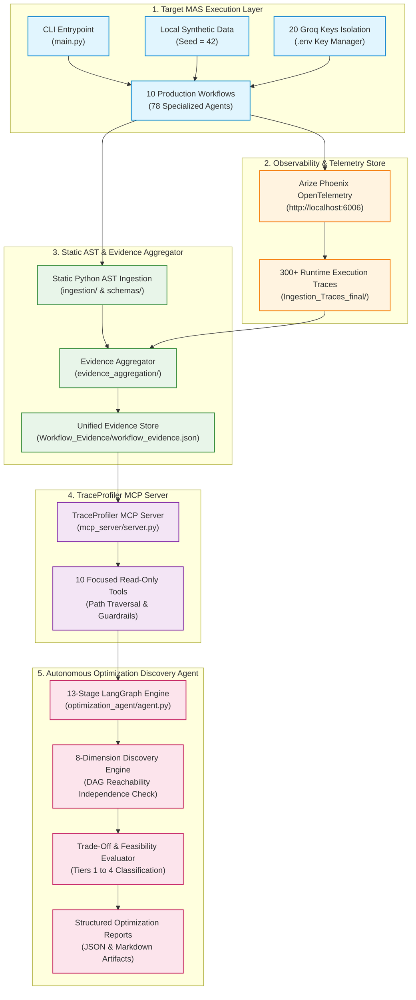

---

## 3. The 5 Foundational Pillars

### Pillar 1: Target-MAS Baselines (10 Workflows, 78 Agents)

The core workflow catalog contains 10 end-to-end enterprise systems built on CrewAI and LiteLLM:
* **Mandatory Model Enforcement:** Strictly runs on Groq's `openai/gpt-oss-120b`. Any other model raises a fatal initialization error.
* **Deterministic Core Logic:** Line item arithmetic, 3-way matching, total landed cost (TLC), MCDA scoring, SLA severity, and inventory formulas (EOQ, safety stock) run in pure deterministic Python.
* **Zero Cloud Lock-in:** Datasets are generated locally via `generate_dummy_data.py` (fixed seed = 42).

| # | Workflow Name | CLI Alias | Agents | Primary Objective |
| :-: | :--- | :---: | :---: | :--- |
| **1** | **Invoice Processing & Accounts Payable** | `invoice` | 8 | Invoice parsing, arithmetic check, 3-way PO match, AP compliance, duplicate detection, approval. |
| **2** | **Customer Support Resolution** | `support` | 6 | Ticket triage, SLA/SOP retrieval, technical root-cause investigation, resolution planning, empathetic response, QA. |
| **3** | **Procurement & Supplier Selection** | `procurement` | 9 | Bid normalization, vendor profiling, lead-time logistics, supplier risk, contract review, TLC, MCDA ranking, award. |
| **4** | **Sales Lead Qualification** | `sales` | 7 | Firmographic enrichment, ICP fit scoring (0–100), intent signal analysis, BANT viability, SDR routing, pipeline battlecards. |
| **5** | **Recruitment & Resume Screening** | `recruitment` | 8 | Resume intake, qualification extraction with evidence IDs (`EVD-*`), job criteria mapping, tenure/gap analysis, recruiter summary. |
| **6** | **Inventory Replenishment Planning** | `inventory` | 6 | Usable stock calculation, demand forecasting, supplier MOQ/pack size, gross deficit calculation, EOQ, purchase order generation. |
| **7** | **Contract Review & Compliance** | `contract` | 10 | Document intake (MSA/NDA/DPA/SLA), clause extraction (`CLS-*`), policy mapping, deviation quantification, risk/ambiguity, consistency check, redlines. |
| **8** | **IT Incident Triage & Remediation** | `incident` | 7 | Alert ingestion, failure domain classification, log correlation, runbook retrieval, SLA severity (SEV 1–4), remediation planning, review. |
| **9** | **Employee Expense Reimbursement** | `expense` | 8 | Multi-currency receipt parsing, GL coding, FX rate normalization, arithmetic verification, corporate travel policy audit, duplicate detection, approval. |
| **10** | **Market & Competitor Research** | `market` | 9 | Research scope decomposition, competitor profiling, product feature mapping, pricing normalization, customer sentiment, SWOT matrix synthesis, fact-check. |

---

### Pillar 2: Static Python AST Ingestion Engine

Located in [`Target-MAS-Dataset-main/ingestion/`](file:///c:/Users/radhi/Desktop/Target-MAS-Dataset-main/Target-MAS-Dataset-main/ingestion) and [`Target-MAS-Dataset-main/schemas/`](file:///c:/Users/radhi/Desktop/Target-MAS-Dataset-main/Target-MAS-Dataset-main/schemas).

A pure Python standard library `ast` analyzer that statically deconstructs agent codebases with **zero code execution**:
* Extracts CrewAI `Agent(...)` declarations: roles, goals, backstories, tools, memory flags, LLM models, and exact line number provenance.
* Extracts `Task(...)` definitions: task descriptions, expected outputs, input dependencies, and sequential/hierarchical Crew graphs.
* Validates output against [`WorkflowContextSchema`](file:///c:/Users/radhi/Desktop/Target-MAS-Dataset-main/Target-MAS-Dataset-main/schemas/workflow_context_schema.py) producing standardized 12-section `workflow_context.json` artifacts.

---

### Pillar 3: Unified Evidence Aggregation System

Located in [`Target-MAS-Dataset-main/evidence_aggregation/`](file:///c:/Users/radhi/Desktop/Target-MAS-Dataset-main/Target-MAS-Dataset-main/evidence_aggregation).

Bridges static code intelligence with empirical runtime ground truth:
* Aggregates static `workflow_context.json` with over **300 runtime execution traces** located in [`Ingestion_Traces_final/Ingestion_Traces/`](file:///c:/Users/radhi/Desktop/Target-MAS-Dataset-main/Ingestion_Traces_final/Ingestion_Traces).
* Computes statistical distributions (min, median, mean, max) for latency, prompt tokens, completion tokens, execution order permutations, and estimated cost (\$ USD).
* Tags every fact with one of three explicit provenance tiers:
  1. `declared`: Stated in manifest or agent constructor.
  2. `statically_observed`: Extracted via static AST inspection.
  3. `runtime_observed`: Derived from empirical trace executions.
* Stores final validated artifacts at [`Workflow_Evidence/<workflow_id>/workflow_evidence.json`](file:///c:/Users/radhi/Desktop/Target-MAS-Dataset-main/Workflow_Evidence).

---

### Pillar 4: TraceProfiler MCP Evidence Server

Located in [`Target-MAS-Dataset-main/mcp_server/`](file:///c:/Users/radhi/Desktop/Target-MAS-Dataset-main/Target-MAS-Dataset-main/mcp_server).

An official **Model Context Protocol (MCP)** server providing 10 focused read-only tools to inspect evidence without dumping full multi-megabyte JSON files:

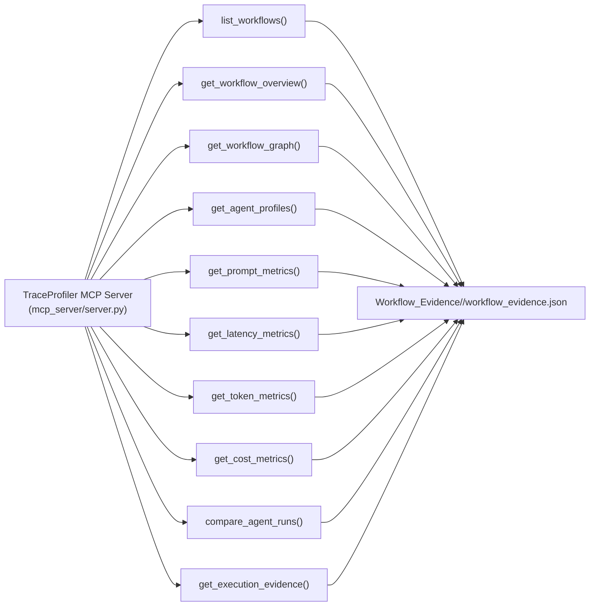

#### MCP Tool Reference & Guardrails:
* `list_workflows`: Enumerates available workflows, agent counts, and trace processing status.
* `get_workflow_overview`: High-level summary of total runs, success rates, aggregate latency, and model verification.
* `get_workflow_graph`: DAG nodes and edges with topological relationship types; preserves isolated nodes.
* `get_agent_profiles`: Granular view of roles, goals, backstories, tools, inputs, and outputs.
* `get_prompt_metrics`: Word counts, character lengths, prompt tokens, and full un-truncated prompt texts.
* `get_latency_metrics`: Latency percentiles and execution durations per agent.
* `get_token_metrics`: Input prompt vs. output completion token breakdown per agent.
* `get_cost_metrics`: Operational dollar-cost estimations based on token pricing models.
* `compare_agent_runs`: Historical duration, token, and status variance across up to 30 recorded runs.
* `get_execution_evidence`: Exact sample inputs, outputs, and tool calls for a specific run ID.

**Security Guardrails:** Full path traversal protection (`..`, `/`, `\`), strict custom directory validation, and zero metric fabrication.

---

### Pillar 5: Autonomous Optimization Discovery Agent

Located in [`Target-MAS-Dataset-main/optimization_agent/`](file:///c:/Users/radhi/Desktop/Target-MAS-Dataset-main/Target-MAS-Dataset-main/optimization_agent).

A **13-stage sequential LangGraph `StateGraph`** agent that inspects workflows via MCP tools, investigates 8+ dimensions without human guidance, and compiles comprehensive optimization reports.

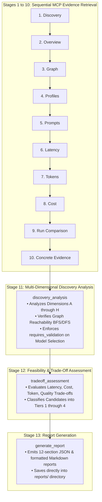

#### The 8 Mandatory Optimization Dimensions:
* **A. Agent Pruning:** Detects and flags redundant verification agents that act as mere pass-throughs in low-risk scenarios.
* **B. Agent Consolidation:** Merges tightly-coupled sequential agent pairs into a single prompt context, eliminating intermediate serialization and handoff overhead.
* **C. Workflow Parallelization:** Discovers concurrent execution branches using graph reachability (BFS/DFS) and strict input/output independence verification.
* **D. Model Selection:** Routes routine syntax and extraction tasks to smaller, faster models (strictly marked `requires_validation=True`).
* **E. Prompt Optimization:** Eliminates repeated role narratives, prompt bloat, and verbose instructions.
* **F. Tool Optimization:** Audits unused tools and introduces deterministic memoization caching.
* **G. Communication & Handoff:** Replaces monolithic state passing with compact, typed delta handoffs.
* **H. Additional Optimization:** Explores fast-path early exits, dynamic routing, and reflection pruning.

#### Action Plan Feasibility Tiers:
* **Tier 1 (High Potential, Low Trade-Off):** Immediate implementation candidates with negligible risk.
* **Tier 2 (High Potential, Moderate Trade-Off):** Strong candidates that require pre-deployment shadow testing or schema validation (e.g. Model Selection).
* **Tier 3 (Potential Benefit, High Trade-Off):** Aggressive changes that may impact output quality; proceed with caution.
* **Tier 4 (Insufficient Evidence):** Flagged for ongoing telemetry observation.

---

## 4. Task-Based 20-Key Groq Distribution Manager

To prevent cross-dimension quota starvation and rate-limit contention during autonomous discovery, keys are logically assigned rather than cycled via naive round-robin:

| Key Range | Logical Task Assignment | Architectural Purpose |
| :--- | :--- | :--- |
| `GROQ_API_KEY_1`, `GROQ_API_KEY_2` | `discovery_overview` | Baseline reconciliation and workflow metadata extraction |
| `GROQ_API_KEY_3` | `agent_pruning` | Dimension A: Redundant agent identification and pass-through auditing |
| `GROQ_API_KEY_4` | `agent_consolidation` | Dimension B: Sequential agent pair merging and unified instructions |
| `GROQ_API_KEY_5` | `workflow_parallelization` | Dimension C: Independent branch discovery and scatter-gather analysis |
| `GROQ_API_KEY_6` | `model_selection` | Dimension D: Model tiering and task complexity evaluation |
| `GROQ_API_KEY_7` | `prompt_optimization` | Dimension E: Prompt bloat compression and prefill token reduction |
| `GROQ_API_KEY_8` | `tool_optimization` | Dimension F: Tool usage auditing and memoization caching |
| `GROQ_API_KEY_9` | `communication_optimization` | Dimension G: Inter-agent state serialization and delta handoff design |
| `GROQ_API_KEY_10` | `additional_optimization` | Dimension H: Early exits, dynamic routing, reflection pruning |
| `GROQ_API_KEY_11`, `GROQ_API_KEY_12` | `tradeoff_assessment` | Feasibility evaluation, risk-benefit scoring, Tier 1–4 classification |
| `GROQ_API_KEY_13`, `GROQ_API_KEY_14` | `report_generation` | Executive summary synthesis and final report compilation |
| `GROQ_API_KEY_15` to `GROQ_API_KEY_20` | `failover_pool` | Automatic failover pool with exponential backoff handling HTTP 429s |

*Security Guarantee:* All keys are masked (`gsk_***...PW`) in logs, state objects, and reports. Zero secrets are ever exposed.

---

## 5. Complete Workflow Catalog & Diagrams

### Workflow 1: Invoice Processing & Accounts Payable (8 Agents)
*Key: `GROQ_API_KEY_1` | Path: [`Agents/invoice_processing/`](file:///c:/Users/radhi/Desktop/Target-MAS-Dataset-main/Target-MAS-Dataset-main/Agents/invoice_processing)*

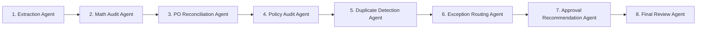

---

### Workflow 2: Customer Support Resolution (6 Agents)
*Key: `GROQ_API_KEY_2` | Path: [`Agents/customer_support/`](file:///c:/Users/radhi/Desktop/Target-MAS-Dataset-main/Target-MAS-Dataset-main/Agents/customer_support)*

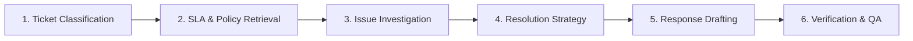

---

### Workflow 3: Procurement & Supplier Selection (9 Agents)
*Key: `GROQ_API_KEY_3` | Path: [`Agents/procurement_supplier_selection/`](file:///c:/Users/radhi/Desktop/Target-MAS-Dataset-main/Target-MAS-Dataset-main/Agents/procurement_supplier_selection)*

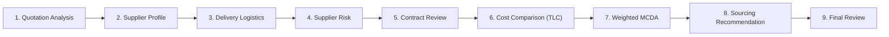

---

### Workflow 4: Sales Lead Qualification (7 Agents)
*Key: `GROQ_API_KEY_4` | Path: [`Agents/sales_lead_qualification/`](file:///c:/Users/radhi/Desktop/Target-MAS-Dataset-main/Target-MAS-Dataset-main/Agents/sales_lead_qualification)*

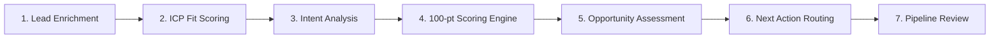

---

### Workflow 5: Recruitment & Resume Screening (8 Agents)
*Key: `GROQ_API_KEY_5` | Path: [`Agents/recruitment_screening/`](file:///c:/Users/radhi/Desktop/Target-MAS-Dataset-main/Target-MAS-Dataset-main/Agents/recruitment_screening)*

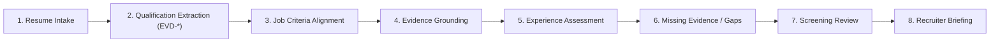

---

### Workflow 6: Inventory Replenishment Planning (6 Agents)
*Key: `GROQ_API_KEY_6` | Path: [`Agents/inventory_replenishment/`](file:///c:/Users/radhi/Desktop/Target-MAS-Dataset-main/Target-MAS-Dataset-main/Agents/inventory_replenishment)*

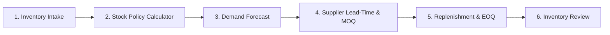

---

### Workflow 7: Contract Review & Compliance (10 Agents)
*Key: `GROQ_API_KEY_7` | Path: [`Agents/contract_review/`](file:///c:/Users/radhi/Desktop/Target-MAS-Dataset-main/Target-MAS-Dataset-main/Agents/contract_review)*

```mermaid
flowchart LR
    G1["1. Contract Intake"] --> G2["2. Clause Extraction (CLS-*)"]
    G2 --> G3["3. Policy Interpretation"]
    G3 --> G4["4. Clause Mapping"]
    G4 --> G5["5. Deviation Analysis"]
    G5 --> G6["6. Risk & Ambiguity"]
    G6 --> G7["7. Consistency Audit"]
    G7 --> G8["8. Citation Validation"]
    G8 --> G9["9. Independent Legal Review"]
    G9 --> G10["10. Final Redline Report"]
```

---

### Workflow 8: IT Incident Triage & Remediation (7 Agents)
*Key: `GROQ_API_KEY_8..14` | Path: [`Agents/incident_triage/`](file:///c:/Users/radhi/Desktop/Target-MAS-Dataset-main/Target-MAS-Dataset-main/Agents/incident_triage)*

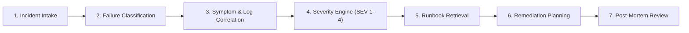

---

### Workflow 9: Employee Expense Reimbursement (8 Agents)
*Key: `GROQ_API_KEY_8..14` | Path: [`Agents/expense_reimbursement/`](file:///c:/Users/radhi/Desktop/Target-MAS-Dataset-main/Target-MAS-Dataset-main/Agents/expense_reimbursement)*

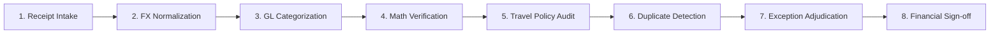

---

### Workflow 10: Market & Competitor Research (9 Agents)
*Key: `GROQ_API_KEY_8..14` | Path: [`Agents/market_research/`](file:///c:/Users/radhi/Desktop/Target-MAS-Dataset-main/Target-MAS-Dataset-main/Agents/market_research)*

```mermaid
flowchart LR
    J1["1. Scope Decomposition"] --> J2["2. Competitor Profiling"]
    J2 --> J3["3. Product Capabilities"]
    J3 --> J4["4. Commercial Pricing"]
    J4 --> J5["5. Customer Sentiment"]
    J5 --> J6["6. Source Evidence"]
    J6 --> J7["7. SWOT Comparison"]
    J7 --> J8["8. Market Synthesis"]
    J8 --> J9["9. Fact-Check Validation"]
```

---

## 6. Repository Directory Structure

```text
Target-MAS-Dataset-main/
│
├── .env                                       # Active environment variables (Groq keys, Phoenix endpoints)
├── .env.example                               # Template for required environment variables
├── requirements.txt                           # Pinned Python dependencies
├── README.md                                  # Comprehensive documentation (This file)
├── BRAIN.md                                   # Master architectural & technical blueprint
├── main.py                                    # Central CLI entry point for listing, validating, running
├── test_all_10_workflows.py                   # Automated end-to-end execution runner for all 10 workflows
├── generate_dummy_data.py                     # Deterministic offline synthetic dataset generator (seed=42)
├── launch_phoenix.bat                         # Batch script to launch Arize Phoenix server
├── run_workflow.bat                           # Convenience script to run workflows via CLI
│
├── common/                                    # Shared Core Infrastructure & Observability
│   ├── settings.py                            # Model enforcement (openai/gpt-oss-120b), paths, Phoenix
│   ├── api_key_manager.py                     # 78-agent registry, per-workflow key routing, safe masking
│   ├── agent_runner.py                        # CrewAI LLM agent factory, LiteLLM parameter normalization
│   ├── tracing.py                             # Arize Phoenix OpenTelemetry tracing
│   ├── metrics.py                             # MetricsTracker: latency, token, and cost accounting
│   └── validation.py                          # Pydantic schemas, deterministic regex JSON extractor
│
├── schemas/                                   # Workflow Context Schemas
│   ├── __init__.py                            # Schema package exports
│   └── workflow_context_schema.py             # Pydantic contract for 12-section workflow_context.json
│
├── ingestion/                                 # Static Python AST Ingestion Engine
│   ├── __init__.py                            # Ingestion package exports
│   ├── ast_parser.py                          # Safe AST parser visitor, literal evaluation
│   ├── agent_extractor.py                     # Static extractor for Agent definitions, roles, goals, tools
│   ├── workflow_analyzer.py                   # Static extractor for Task definitions and Crew DAGs
│   ├── context_generator.py                   # Context synthesizer compiling AST data
│   └── orchestrator.py                        # Batch orchestrator running AST ingestion across all workflows
│
├── evidence_aggregation/                      # Unified Evidence Aggregation System
│   ├── __init__.py                            # Evidence aggregation package exports
│   ├── schema.py                              # Pydantic schema for workflow_evidence.json
│   ├── aggregator.py                          # Aggregates static AST contexts + 300+ runtime traces
│   └── validators.py                          # Integrity, acyclicity, and schema validators
│
├── Workflow_Evidence/                         # Unified Authoritative Evidence Store
│   ├── <workflow_id>/workflow_evidence.json   # 1 validated JSON artifact per workflow
│
├── mcp_server/                                # TraceProfiler MCP Evidence Server
│   ├── __init__.py                            # MCP server package exports
│   ├── tools.py                               # 10 focused read-only tools with path traversal protection
│   └── server.py                              # FastMCP / MCPServer execution entrypoint
│
├── optimization_agent/                        # Autonomous Optimization Discovery Agent (LangGraph)
│   ├── __init__.py                            # Optimization agent exports
│   ├── key_manager.py                         # 20 Groq keys manager: logical distribution, failover, masking
│   ├── state.py                               # TypedDict state for 13-stage LangGraph pipeline
│   ├── pipeline.py                            # Sequential MCP evidence retrieval nodes (Stages 1–10)
│   ├── discovery.py                           # 8-dimension discovery engine with BFS/DFS independence checks
│   ├── tradeoff.py                            # Feasibility & trade-off evaluator (Tier 1–4 classification)
│   ├── report.py                              # Report generator compiling 12-section JSON and Markdown
│   └── agent.py                               # LangGraph StateGraph builder, compiler, and runner
│
├── Agents/                                    # Target Multi-Agent Systems (10 Workflows, 78 Agents)
│   └── <workflow_id>/                         # Agent definitions, workflow.py, and workflow.json
│
├── data/                                      # Local Synthetic Datasets (Seed = 42)
│   └── <workflow_id>/                         # Invoices, tickets, quotes, leads, resumes, SKUs, etc.
│
├── Ingestion_Traces_final/                    # 300 Validated Execution Traces (30 traces per workflow)
│   └── Ingestion_Traces/<workflow_id>/
│
├── runs/                                      # Runtime Execution Logs and Trace Summaries
│   ├── combined_10_workflows_test_summary.json# Master execution summary
│   └── runs_summary.jsonl                     # Global streaming execution summary log
│
├── reports/                                   # Generated Optimization & Ingestion Reports
│   ├── <workflow>_optimization_report.json    # 12-section machine-readable report
│   └── <workflow>_optimization_report.md      # Human-readable Markdown summary report
│
└── tests/                                     # Automated Test Suite (57 Passing Tests)
    ├── test_optimization_agent.py             # Checkpoints 1–6 (MCP, Pipeline, Dimensions, Tiers, Keys)
    ├── test_evidence_aggregation.py           # Validates aggregator and workflow_evidence.json
    ├── test_mcp_tools.py                      # Validates 10 MCP tools, path traversal, isolated nodes
    ├── test_ast_analyzer.py                   # Validates AST visitor parsing and literal extraction
    ├── test_structure_and_manifests.py        # Validates 78 agent count and uniform model constraint
    └── ...                                    # Additional unit and integration test fixtures
```

---

## 7. Installation & Quickstart

### Prerequisites
* Python 3.10 or higher
* Groq Cloud API Key(s)

### 1. Clone & Set Up Environment
```bash
git clone https://github.com/<org>/Target-MAS-Dataset.git
cd Target-MAS-Dataset

# Create virtual environment
python -m venv venv
source venv/bin/activate  # On Windows: venv\Scripts\activate

# Install dependencies
pip install -r requirements.txt
```

### 2. Configure Environment Variables
Copy the template and populate your Groq API keys in `.env`:
```bash
cp .env.example .env
```
Ensure you provide at least `GROQ_API_KEY_1` through `GROQ_API_KEY_14` (or up to `GROQ_API_KEY_20` for full optimization agent distribution).

### 3. Generate Local Datasets (Deterministic Seed = 42)
```bash
python generate_dummy_data.py
```

---

## 8. CLI & Execution Commands

The central CLI is provided via [`main.py`](file:///c:/Users/radhi/Desktop/Target-MAS-Dataset-main/Target-MAS-Dataset-main/main.py):

```bash
# List all 10 registered multi-agent workflows
python main.py list

# Validate all configured Groq API keys and agent bindings
python main.py validate-keys

# Execute a single workflow (e.g. Contract Review)
python main.py run contract

# Execute a single workflow with a specific sample ID
python main.py run invoice --id INV-2026-001

# Run live smoke test on a workflow
python main.py live-smoke --workflow customer_support

# Run zero-execution static Python AST analysis across all 10 workflows
python main.py ast-analyze --json

# Launch local Arize Phoenix observability server
python main.py launch-phoenix --port 6006
```

---

## 9. Running the MCP Server & Optimization Agent

### Launch the TraceProfiler MCP Evidence Server
Run the MCP server over stdio for model context inspection:
```bash
python -m mcp_server.server
```

### Run the Autonomous Optimization Discovery Agent
Execute the 13-stage LangGraph optimization discovery engine programmatically:

```python
from optimization_agent import OptimizationDiscoveryAgent

# Initialize the 13-stage LangGraph agent
agent = OptimizationDiscoveryAgent()

# Run autonomous discovery on target workflow
result_state = agent.run("contract_review")

# Discovered opportunities and action plan:
print(f"Discovered candidates: {len(result_state['candidates'])}")
print(f"Tier 1 opportunities: {len(result_state['tier_1_immediate'])}")

# Output artifacts generated:
# - reports/contract_review_optimization_report.json
# - reports/contract_review_optimization_report.md
```

Sample output report summary from [`reports/contract_review_optimization_report.md`](file:///c:/Users/radhi/Desktop/Target-MAS-Dataset-main/Target-MAS-Dataset-main/reports/contract_review_optimization_report.md):
```markdown
# Autonomous Optimization Discovery Report: contract_review
Projected Cumulative Impact:
- Critical Path Latency Reduction: ~35.0%
- Workflow Token Savings: ~28.0%
- Operational Cost Savings: ~32.0%
- Discovered: 12 Tier 1 immediate opportunities, 6 Tier 2 validated candidates
```

---

## 10. Tracing & Observability with Arize Phoenix

The framework includes zero-configuration OpenTelemetry tracing:
1. Launch Phoenix locally:
   ```bash
   launch_phoenix.bat
   # Or via CLI:
   python main.py launch-phoenix
   ```
2. Open your browser to `http://localhost:6006`.
3. As workflows execute, all spans, agent thoughts, tool invocations, token counts, and execution latencies stream directly to your local dashboard.

---

## 11. Automated Test Suite (57 Passing Tests)

The repository maintains an automated test suite with **57 passing tests** verifying all architectural invariants:

```bash
pytest tests/ -v
```

### Test Coverage Highlights:
* [`test_optimization_agent.py`](file:///c:/Users/radhi/Desktop/Target-MAS-Dataset-main/Target-MAS-Dataset-main/tests/test_optimization_agent.py): Validates Checkpoints 1–6: all 10 MCP tools, path traversal immunity, stage sequencing, all 8 optimization dimensions, DAG reachability dependency checks, model selection flags, Tiers 1–4, and end-to-end report generation.
* [`test_evidence_aggregation.py`](file:///c:/Users/radhi/Desktop/Target-MAS-Dataset-main/Target-MAS-Dataset-main/tests/test_evidence_aggregation.py): Validates static+trace aggregator, Pydantic schemas, and statistical integrity across all 10 workflows.
* [`test_mcp_tools.py`](file:///c:/Users/radhi/Desktop/Target-MAS-Dataset-main/Target-MAS-Dataset-main/tests/test_mcp_tools.py): Validates path traversal guardrails, custom directories, full prompt retrieval, isolated node retention, and execution evidence lookup.
* [`test_structure_and_manifests.py`](file:///c:/Users/radhi/Desktop/Target-MAS-Dataset-main/Target-MAS-Dataset-main/tests/test_structure_and_manifests.py): Verifies exact 78 agent count and uniform model constraint (`openai/gpt-oss-120b`).
* [`test_dataset_generator.py`](file:///c:/Users/radhi/Desktop/Target-MAS-Dataset-main/Target-MAS-Dataset-main/tests/test_dataset_generator.py): Verifies 100% offline synthetic data reproducibility (seed=42).

---

## 12. License & Attribution

This project is licensed under the **MIT License**. See [`LICENSE`](file:///c:/Users/radhi/Desktop/Target-MAS-Dataset-main/Target-MAS-Dataset-main/LICENSE) for details.

Built for the systematic benchmarking, empirical tracing, and autonomous optimization of production Multi-Agent Systems.

