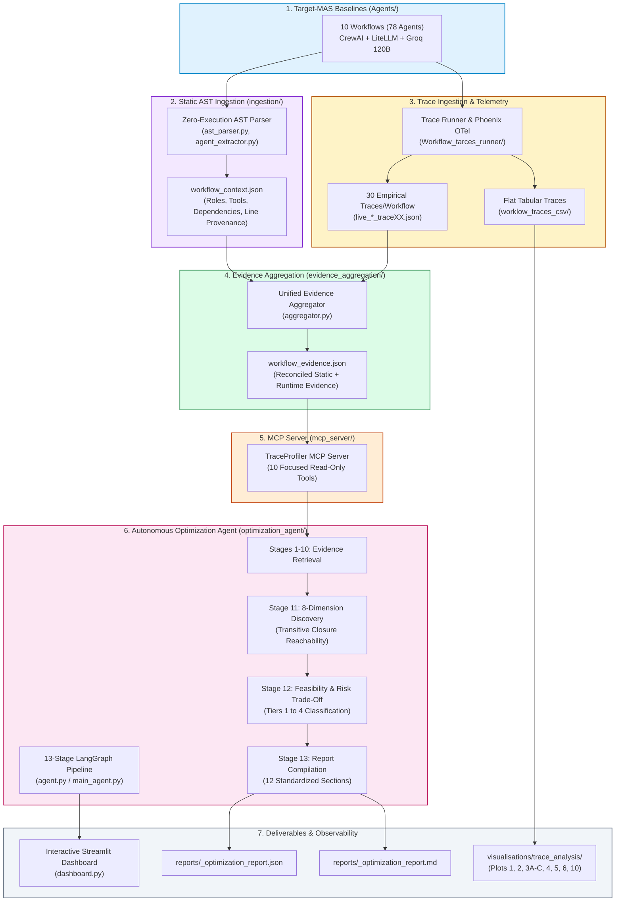

# MEGA-BRAIN: Master Technical & Architectural Blueprint
## The Unified Reference Manual for the Agentic Workflow Optimizer (AWO) & TraceProfiler Platform

---

## 1. Executive Summary & System Philosophy

The **Agentic Workflow Optimizer (AWO)** / **TraceProfiler** platform is an autonomous, evidence-grounded research and optimization engine for production-grade Multi-Agent Systems (MAS).

Modern multi-agent architectures (built on frameworks like CrewAI, LangGraph, or AutoGen) frequently suffer from compounding latency bottlenecks, prompt bloat, redundant validation loops, and excessive LLM token expenditure. Traditional approaches to optimizing these pipelines rely on manual inspection or naive LLM prompting, which lead to hallucinations, broken data contracts, and unvalidated architectural changes.

**TraceProfiler solves this by establishing a zero-hallucination, evidence-grounded optimization lifecycle:**



---

## 2. Complete Repository Architecture & File Directory

```text
Target-MAS-Dataset-main/
│
├── .env                                       # Active local environment variables (Groq keys 1-20, Phoenix)
├── .env.example                               # Template for required environment variables
├── requirements.txt                           # Core dependencies (langgraph, crewai, mcp, litellm, pydantic)
├── README.md                                  # User-facing setup & quickstart guide
├── BRAIN.md                                   # Original architecture manual
├── OPTIMIZATION_AGENT_BRAIN.md                # Optimization agent deep-dive manual
├── MEGA-BRAIN.md                              # Unified complete technical specification (This document)
├── main.py                                    # Central CLI entry point (run-workflow, live-smoke, launch-phoenix)
├── test_all_10_workflows.py                   # Automated test harness running smoke tests on all 10 workflows
├── generate_dummy_data.py                     # Deterministic synthetic dataset generator (seed=42)
├── launch_phoenix.bat                         # Batch launcher for Arize Phoenix UI on port 6006
├── run_new_dashboard.bat                      # Batch launcher for Streamlit Dashboard on port 8501
├── dashboard.py                               # Fresh 2-Tab Streamlit interactive execution & report dashboard
├── convert_traces_to_csv.py                   # JSON-to-CSV trace flattening pipeline (1 CSV per workflow)
├── generate_trace_visualizations.py           # Matplotlib/Seaborn visualization pipeline (Plots 1, 2, 3A-C, 4, 5, 6, 10)
│
├── Agents/                                    # Target-MAS: 10 Baseline Workflows (78 Agents)
│   ├── contract_review/                       # 10 Agents (Intake, Clause, Risk, Deviation, Compliance, etc.)
│   ├── customer_support/                      # 6 Agents (Triage, Policy, Investigation, Resolution, Draft, QA)
│   ├── expense_reimbursement/                 # 8 Agents (Receipt, Normalization, Policy, Duplicate, Approval, etc.)
│   ├── incident_triage/                       # 7 Agents (Intake, Classification, Runbook, Severity, Remediation)
│   ├── inventory_replenishment/               # 6 Agents (Stock, Forecasting, Supplier, Reorder, Purchase Order)
│   ├── invoice_processing/                    # 8 Agents (OCR, Extraction, Vendor, 3-Way Match, Tax, Approval)
│   ├── market_research/                       # 9 Agents (Query, Competitor, Product, Pricing, Sentiment, Synthesis)
│   ├── procurement_supplier_selection/        # 9 Agents (Requisition, Catalog, Scoring, Compliance, Negotiation)
│   ├── recruitment_screening/                 # 8 Agents (Resume, Job Spec, Skill, Experience, Score, Shortlist)
│   └── sales_lead_qualification/              # 7 Agents (Lead Intake, Enrichment, ICP Scoring, BANT, Routing)
│
├── common/                                    # Core Shared Infrastructure & Telemetry
│   ├── settings.py                            # Mandatory model constraint (openai/gpt-oss-120b), paths, key pools
│   ├── api_key_manager.py                     # 78-agent key registry, per-agent routing, safe key masking
│   ├── agent_runner.py                        # CrewAI agent factory, task dependency resolution, execution engine
│   ├── tracing.py                             # Arize Phoenix OpenTelemetry tracing, spans, LiteLLM instrumentation
│   ├── metrics.py                             # MetricsTracker: duration, prompt/completion tokens, cost tracking
│   └── validation.py                          # Robust JSON extraction, Pydantic data contract validation
│
├── ingestion/                                 # Static Python AST Ingestion Engine (Zero Execution)
│   ├── ast_parser.py                          # Abstract Syntax Tree parser, literal evaluator, scope resolver
│   ├── agent_extractor.py                     # Static extractor for Agent roles, goals, backstories, tools, models
│   ├── workflow_analyzer.py                   # Static extractor for Tasks, dependencies, execution flows
│   ├── context_generator.py                   # Compiles AST structures into workflow_context.json
│   └── orchestrator.py                        # Batch runner for AST extraction across all 10 workflows
│
├── schemas/                                   # Pydantic Structural Schemas
│   └── workflow_context_schema.py             # 12-section schema defining workflow_context.json
│
├── Workflow_tarces_runner/                    # Dedicated Empirical Trace Generation Runners
│   ├── run_contract_review_traces.py          # 30 live runs with 1-to-1 Groq keys (Keys 1..10)
│   ├── run_customer_support_traces.py         # 30 live runs with 1-to-1 Groq keys (Keys 1..6)
│   ├── run_invoice_processing_traces.py       # 30 live runs with 1-to-1 Groq keys (Keys 1..8)
│   └── ...                                    # Dedicated trace generators for all 10 workflows
│
├── Ingestion_Traces_final/                    # Persisted Empirical Execution Traces
│   └── Ingestion_Traces/<workflow>/           # 30 trace JSON files (live_*_trace01.json to trace30.json)
│
├── worklow_traces_csv/                        # Tabular Trace Datasets (1 CSV per workflow, 20 columns)
│   ├── contract_review/contract_review.csv    # 300 rows (30 runs × 10 agents)
│   ├── customer_support/customer_support.csv  # 180 rows (30 runs × 6 agents)
│   └── ... (all 10 workflows)                 # Total 2,340 agent execution rows
│
├── visualisations/trace_analysis/             # Matplotlib/Seaborn High-Resolution Visualizations
│   ├── plot1_workflow_latency_distribution.png
│   ├── plot2_workflow_token_distribution.png
│   ├── plot3a_workflow_latency_trend.png
│   ├── plot3b_workflow_token_trend.png
│   ├── plot3c_workflow_cost_trend.png
│   ├── plot4_agent_latency_distribution.png
│   ├── plot5_agent_token_distribution.png
│   ├── plot6_agent_prompt_vs_completion_tokens.png
│   └── plot10_agent_latency_percentiles.png
│
├── evidence_aggregation/                      # Unified Evidence Aggregation System
│   ├── schema.py                              # Pydantic schema for unified workflow_evidence.json
│   ├── aggregator.py                          # Aggregates AST context + 30 empirical traces into evidence
│   └── validators.py                          # Statistical and architectural integrity validators
│
├── Workflow_Evidence/<workflow>/              # Aggregated Evidence Artifacts
│   └── workflow_evidence.json                 # Reconciled AST + runtime evidence document
│
├── mcp_server/                                # TraceProfiler Model Context Protocol (MCP) Server
│   ├── server.py                              # FastMCP server registration and startup
│   └── tools.py                               # 10 focused read-only evidence access tools
│
├── optimization_agent/                        # Autonomous Optimization Discovery Agent (LangGraph)
│   ├── state.py                               # OptimizationAgentState & OptimizationCandidate TypedDicts
│   ├── agent.py                               # 13-stage LangGraph StateGraph builder and runner
│   ├── pipeline.py                            # Stages 1 to 10: Sequential MCP tool retrieval nodes
│   ├── discovery.py                           # Stage 11: 8-Dimension Discovery Engine (Transitive Closure)
│   ├── tradeoff.py                            # Stage 12: Feasibility & Risk Trade-Off Evaluator (Tiers 1–4)
│   ├── report.py                              # Stage 13: 12-Section JSON & Markdown report generator
│   ├── key_manager.py                         # 20-Key Groq API manager, task allocation, failover pool
│   └── main_agent.py                          # LangGraph orchestrator defining the 3 dedicated agent personas
│
├── reports/                                   # Final Generated Optimization Deliverables
│   ├── <workflow>_optimization_report.json    # Machine-readable 12-section audit deliverable
│   └── <workflow>_optimization_report.md      # Executive summary, visual tables, sprint roadmaps
│
└── tests/                                     # Automated Pytest Suite
    ├── test_ast_analyzer.py                   # AST ingestion unit tests
    ├── test_evidence_aggregation.py           # Evidence aggregation verification
    ├── test_mcp_tools.py                      # MCP 10 tools functional tests
    ├── test_optimization_agent.py             # 13-stage optimization agent test suite
    └── test_trace_to_csv.py                   # Trace CSV conversion verification
```

---

## 3. Layer 1: Target-MAS Baselines & Multi-Agent Workflows

### 3.1 Design Principles
1. **Uniform Architecture:** Built on CrewAI with LiteLLM routing.
2. **Mandatory Model:** Strictly enforced to `openai/gpt-oss-120b` across all 10 workflows and 78 agents via [`common/settings.py`](file:///c:/Users/radhi/Desktop/Target-MAS-Dataset-main/Target-MAS-Dataset-main/common/settings.py).
3. **Dedicated Credential Routing:** 1-to-1 Groq API key allocation per agent or workflow, avoiding shared key rate limits.
4. **Deterministic Core Tasks:** Hybrid execution combining business validation logic with unstructured LLM reasoning.

### 3.2 The 10 Target Workflows

| # | Workflow ID | Declared Agents | Primary Business Domain | Key Complexity Driver |
| :-: | :--- | :-: | :--- | :--- |
| 1 | `contract_review` | 10 | Legal & Risk Audit | Cross-clause contradiction, regulatory compliance checks |
| 2 | `customer_support` | 6 | IT & Enterprise Support | SLA verification, policy retrieval, customer communications |
| 3 | `expense_reimbursement` | 8 | Corporate Finance | Receipt OCR parsing, duplicate detection, tax policies |
| 4 | `incident_triage` | 7 | DevOps / Site Reliability | Runbook matching, historical symptom diagnosis, remediation |
| 5 | `inventory_replenishment` | 6 | Supply Chain & Logistics | Demand forecasting, safety stock calculation, purchase orders |
| 6 | `invoice_processing` | 8 | Accounts Payable | 3-way line item matching, purchase order reconciliation |
| 7 | `market_research` | 9 | Strategy & Intelligence | Competitor feature matrix, pricing extraction, sentiment |
| 8 | `procurement_supplier_selection` | 9 | Strategic Sourcing | Multi-vendor RFP scoring, compliance audit, negotiation |
| 9 | `recruitment_screening` | 8 | Human Resources | Resume entity extraction, skill mapping, scoring rubrics |
| 10 | `sales_lead_qualification` | 7 | Revenue Operations | ICP scoring, BANT qualification, CRM sync routing |

### 3.3 Concrete Code Implementation: Workflow Chaining

Below is a production code pattern from [`Agents/invoice_processing/workflow.py`](file:///c:/Users/radhi/Desktop/Target-MAS-Dataset-main/Target-MAS-Dataset-main/Agents/invoice_processing/workflow.py) demonstrating agent instantiation, tool binding, and task dependency chaining:

```python
# common/agent_runner.py & Agents/invoice_processing/workflow.py

from crewai import Agent, Crew, Process, Task
from common.settings import MANDATORY_MODEL
from common.api_key_manager import get_key_for_agent

def create_invoice_processing_crew(invoice_data: dict) -> Crew:
    # 1. Instantiate Agent with assigned Groq key and mandatory model
    ocr_key = get_key_for_agent("invoice_processing", "ocr_extraction_agent")
    ocr_agent = Agent(
        role="Invoice OCR Extraction Specialist",
        goal="Extract raw text, tabular data, and metadata from scanned invoice payloads.",
        backstory="Expert document parsing specialist trained on messy multi-page PDF/TIFF invoices.",
        llm=MANDATORY_MODEL,
        verbose=False,
        memory=False,
        tools=[]
    )

    vendor_key = get_key_for_agent("invoice_processing", "vendor_validation_agent")
    vendor_agent = Agent(
        role="Vendor Master Data Auditor",
        goal="Validate vendor tax IDs, remittance addresses, and bank accounts against master vendor database.",
        backstory="Compliance auditor ensuring payments route to registered, non-sanctioned corporate entities.",
        llm=MANDATORY_MODEL,
        verbose=False,
        memory=False,
        tools=[]
    )

    matching_agent = Agent(
        role="Three-Way Matching Specialist",
        goal="Perform 3-way reconciliation between invoice line items, purchase orders, and receiving reports.",
        backstory="Quantitative financial auditor enforcing price tolerances and quantity confirmations.",
        llm=MANDATORY_MODEL,
        verbose=False,
        memory=False,
        tools=[]
    )

    # 2. Define Tasks with explicit sequential context passing
    t1 = Task(
        description=f"Extract header and line items from raw invoice: {invoice_data}",
        expected_output="JSON structure containing vendor_name, invoice_id, line_items, total_amount",
        agent=ocr_agent
    )

    t2 = Task(
        description="Verify extracted vendor against vendor master records.",
        expected_output="Verification status with approved vendor_id or discrepancy flags",
        agent=vendor_agent,
        context=[t1]  # Direct upstream dependency
    )

    t3 = Task(
        description="Verify line items, unit prices, and quantities against PO records.",
        expected_output="Matching summary: perfect_match, tolerance_approved, or quantity_variance",
        agent=matching_agent,
        context=[t1, t2]  # Depends on both OCR extraction and vendor validation
    )

    # 3. Assemble Sequential Crew
    return Crew(
        agents=[ocr_agent, vendor_agent, matching_agent],
        tasks=[t1, t2, t3],
        process=Process.sequential,
        verbose=False
    )
```

---

## 4. Layer 2: Static Python AST Ingestion Engine

### 4.1 Motivation & Design
Executing target code to inspect its structure is unsafe and causes non-deterministic behavior. The **Static AST Ingestion Engine** ([`ingestion/`](file:///c:/Users/radhi/Desktop/Target-MAS-Dataset-main/Target-MAS-Dataset-main/ingestion/)) parses Python code directly using `ast.parse` without executing a single line of target code.

### 4.2 AST Parsing Pipeline Architecture

```
Target Python Files (*.py)
          │
          ▼
┌─────────────────────────────────┐
│ ast_parser.py                   │  Builds AST, tracks line ranges, extracts imports,
│ (ParsedModule)                  │  and provides safe_eval_literal() for constants
└─────────┬───────────────────────┘
          ├────────────────────────────────────────────────┐
          ▼                                                ▼
┌─────────────────────────────────┐      ┌─────────────────────────────────┐
│ agent_extractor.py              │      │ workflow_analyzer.py            │
│ Extracts:                       │      │ Extracts:                       │
│ - Agent() invocations           │      │ - Task() dependencies (context) │
│ - Roles, Goals, Backstories     │      │ - Crew() assembly order         │
│ - Bound tools & LLM configs     │      │ - Directed execution DAG        │
└─────────┬───────────────────────┘      └─────────┬───────────────────────┘
          │                                        │
          └───────────────────┬────────────────────┘
                              ▼
┌──────────────────────────────────────────────────────────┐
│ context_generator.py                                     │
│ Compiles AST artifacts into workflow_context.json        │
│ Validated against schemas/workflow_context_schema.py     │
└──────────────────────────────────────────────────────────┘
```

### 4.3 Production AST Extraction Logic

Below is a snippet from [`ingestion/agent_extractor.py`](file:///c:/Users/radhi/Desktop/Target-MAS-Dataset-main/Target-MAS-Dataset-main/ingestion/agent_extractor.py) illustrating static visitor extraction of `Agent(...)` kwargs:

```python
# ingestion/agent_extractor.py (Production Snippet)

import ast
from typing import Dict, Any, Optional

def extract_agent_from_call(node: ast.Call, source_file: str) -> Optional[Dict[str, Any]]:
    """
    Extracts Agent metadata statically from an ast.Call node without runtime execution.
    """
    # Verify function called is 'Agent'
    func_name = None
    if isinstance(node.func, ast.Name):
        func_name = node.func.id
    elif isinstance(node.func, ast.Attribute):
        func_name = node.func.attr

    if func_name != "Agent":
        return None

    agent_data = {
        "role": None,
        "goal": None,
        "backstory": None,
        "llm": None,
        "tools": [],
        "source_location": {
            "file": source_file,
            "start_line": node.lineno,
            "end_line": getattr(node, "end_lineno", node.lineno)
        }
    }

    # Extract keyword arguments statically
    for kw in node.keywords:
        key = kw.arg
        val_node = kw.value

        if isinstance(val_node, ast.Constant):
            if key in ["role", "goal", "backstory"]:
                agent_data[key] = val_node.value
            elif key == "llm":
                agent_data["llm"] = str(val_node.value)
        elif isinstance(val_node, ast.Name):
            if key == "llm":
                agent_data["llm"] = val_node.id
        elif isinstance(val_node, ast.List):
            if key == "tools":
                for elt in val_node.elts:
                    if isinstance(elt, ast.Name):
                        agent_data["tools"].append(elt.id)
                    elif isinstance(elt, ast.Call) and isinstance(elt.func, ast.Name):
                        agent_data["tools"].append(elt.func.id)

    return agent_data
```

### 4.4 Structure of `workflow_context.json`
The resulting artifact contains 12 standardized sections:
1. `workflow_metadata`: Workflow ID, framework (`crewai`), entry point file.
2. `agents`: List of declared agents with full static configuration and source file line references.
3. `tasks`: List of declared tasks, descriptions, expected outputs, and context dependencies.
4. `workflow_graph`: Graph representation ($V, E$) constructed from task context arrays.
5. `tools`: Bound tools and utility modules.
6. `data_contracts`: Schema definitions for input/output payloads.

---

## 5. Layer 3: Empirical Ingestion Traces & Telemetry

### 5.1 The Need for Empirical Evidence
AST analysis provides static structural intent, but it cannot measure runtime latency variance, prompt expansion, or token consumption. The platform runs each workflow across **30 empirical runs** to collect statistically significant execution telemetry.

### 5.2 Real-Time OpenTelemetry Observability (Arize Phoenix)
Integrated in [`common/tracing.py`](file:///c:/Users/radhi/Desktop/Target-MAS-Dataset-main/Target-MAS-Dataset-main/common/tracing.py):
- **Instrumentation:** Hooks `openinference.instrumentation.crewai.CrewAIInstrumentor` and `openinference.instrumentation.litellm.LiteLLMInstrumentor`.
- **Hierarchical Spans:** Emits nested OpenTelemetry spans (`workflow.<name>` $\to$ `agent.<name>` $\to$ `llm.completion`).
- **Interactive Web UI:** Runs locally at `http://localhost:6006` via `launch_phoenix.bat` to visualize live Gantt waterfall latency charts.

### 5.3 Dedicated Trace Runners (`Workflow_tarces_runner/`)
Each workflow features a standalone runner (e.g. `run_invoice_processing_traces.py`):
- Enforces strict 1-to-1 Groq API key distribution (e.g. Keys 1 to 8 for the 8 invoice agents).
- Captures wall-clock timestamps (`time.perf_counter()`), prompt tokens, completion tokens, and structured outputs.
- Persists raw JSON traces to `Ingestion_Traces_final/Ingestion_Traces/<workflow>/live_*_traceXX.json`.

```json
// Sample Raw Trace Snippet (live_20261031_132411_trace01.json)
{
  "run_id": "live_20261031_132411_trace01",
  "workflow_name": "customer_support",
  "model": "openai/gpt-oss-120b",
  "status": "SUCCESS",
  "duration_seconds": 16.551,
  "agent_execution_count": 6,
  "agent_executions": [
    {
      "order": 1,
      "agent_id": "ticket_classification_agent",
      "status": "SUCCESS",
      "duration_seconds": 2.066,
      "tokens": 726,
      "prompt_tokens": 437,
      "completion_tokens": 289,
      "output": { "category": "account_access", "urgency": "medium" },
      "notes": ""
    }
  ],
  "total_tokens": 8759,
  "prompt_tokens": 5609,
  "completion_tokens": 3150,
  "estimated_cost_usd": 0.005798,
  "timestamp": "2026-10-31T13:24:27.781238+00:00"
}
```

### 5.4 Tabular CSV Conversion Pipeline (`convert_traces_to_csv.py`)
To enable data science, plotting, and tabular analytics without redundant parsing, [`convert_traces_to_csv.py`](file:///c:/Users/radhi/Desktop/Target-MAS-Dataset-main/convert_traces_to_csv.py) converts raw trace files into a single consolidated CSV per workflow under `worklow_traces_csv/<workflow>/<workflow>.csv`.

**Data Contract: 20 Standardized Columns**
- **Workflow-Level Fields (12):** `run_id`, `workflow_name`, `model`, `workflow_status`, `workflow_duration_seconds`, `agent_execution_count`, `total_tokens`, `workflow_prompt_tokens`, `workflow_completion_tokens`, `estimated_cost_usd`, `error_message`, `timestamp`.
- **Agent-Level Fields (8):** `agent_status`, `agent_duration_seconds`, `tokens`, `agent_prompt_tokens`, `agent_completion_tokens`, `notes`, `order`, `agent_id`.
- **Total Dataset Size:** 10 workflows × 30 runs = **2,340 agent execution rows**.

---

## 6. Layer 4: Unified Evidence Aggregator

### 6.1 Purpose & Aggregation Mechanics
The **Evidence Aggregator** ([`evidence_aggregation/aggregator.py`](file:///c:/Users/radhi/Desktop/Target-MAS-Dataset-main/Target-MAS-Dataset-main/evidence_aggregation/aggregator.py)) fuses three disparate inputs into a single, comprehensive evidence file: [`workflow_evidence.json`](file:///c:/Users/radhi/Desktop/Target-MAS-Dataset-main/Target-MAS-Dataset-main/Workflow_Evidence/contract_review/workflow_evidence.json):

1. `workflow.json` (Declared design schema)
2. `workflow_context.json` (Static AST implementation context)
3. 30 × `live_*.json` (Empirical runtime telemetry)

```python
# evidence_aggregation/aggregator.py (Core Reconciliation Logic)

def aggregate_workflow_evidence(workflow_id: str, ast_context: dict, traces: list[dict]) -> dict:
    # 1. Reconcile Declared Agents vs. Observed Runtime Agents
    declared_agents = {a["agent_id"]: a for a in ast_context.get("agents", [])}
    observed_agent_ids = set()
    for trace in traces:
        for exec_step in trace.get("agent_executions", []):
            observed_agent_ids.add(exec_step["agent_id"])

    reconciliation = []
    for ag_id in sorted(set(declared_agents.keys()) | observed_agent_ids):
        status = "RECONCILED"
        if ag_id not in declared_agents:
            status = "OBSERVED_BUT_UNDECLARED"
        elif ag_id not in observed_agent_ids:
            status = "DECLARED_BUT_UNOBSERVED"
        reconciliation.append({"agent_id": ag_id, "reconciliation_status": status})

    # 2. Compute Statistical Metrics Across 30 Runs
    agent_latencies = {}
    for trace in traces:
        for step in trace.get("agent_executions", []):
            ag_id = step["agent_id"]
            agent_latencies.setdefault(ag_id, []).append(step["duration_seconds"])

    stats = {}
    for ag_id, lats in agent_latencies.items():
        stats[ag_id] = {
            "mean_seconds": round(statistics.mean(lats), 3),
            "median_seconds": round(statistics.median(lats), 3),
            "p90_seconds": round(statistics.quantiles(lats, n=10)[8], 3),
            "std_dev_seconds": round(statistics.stdev(lats), 3) if len(lats) > 1 else 0.0,
            "min_seconds": round(min(lats), 3),
            "max_seconds": round(max(lats), 3),
        }

    return {
        "workflow_id": workflow_id,
        "reconciliation": reconciliation,
        "runtime_statistics": stats,
        "static_context": ast_context,
        "sample_evidence": traces[:3]  # Preserves concrete payloads for provenance
    }
```

---

## 7. Layer 5: TraceProfiler MCP Evidence Server

### 7.1 Architecture & Design
The MCP server ([`mcp_server/server.py`](file:///c:/Users/radhi/Desktop/Target-MAS-Dataset-main/Target-MAS-Dataset-main/mcp_server/server.py), [`tools.py`](file:///c:/Users/radhi/Desktop/Target-MAS-Dataset-main/Target-MAS-Dataset-main/mcp_server/tools.py)) is built on Anthropic's **FastMCP** specification. It exposes **10 read-only tools** that query `workflow_evidence.json` with strict path traversal validation and memory-efficient data slicing.

### 7.2 The 10 Focused Evidence Tools

| # | Tool Name | Parameters | Return Schema | Security / Ingestion Guarantee |
| :-: | :--- | :--- | :--- | :--- |
| **1** | `list_workflows` | `evidence_dir: Optional[str]` | `{"workflows": [{"workflow_id", "workflow_name", "total_agents"}]}` | Path validation; never falls back if invalid custom path is provided. |
| **2** | `get_workflow_overview` | `workflow_id: str` | `{"workflow_id", "total_declared_agents", "total_runs", "success_rate", "latency_summary"}` | Traversal sanitization; validates evidence file exists. |
| **3** | `get_workflow_graph` | `workflow_id: str, include_isolated: bool` | `{"workflow_id", "nodes": [...], "edges": [...], "isolated_nodes": [...]}` | Preserves disconnected nodes when `include_isolated=True`. |
| **4** | `get_agent_profiles` | `workflow_id: str, agent_ids: Optional[list]` | `{"workflow_id", "profiles": [{"agent_id", "role", "goal", "tools", "model"}]}` | Returns line provenance; reports unknown IDs in `invalid_agent_ids`. |
| **5** | `get_prompt_metrics` | `workflow_id: str, include_full: bool` | `{"workflow_id", "prompt_metrics": [{"agent_id", "char_count", "est_tokens"}]}` | Token estimates; optional full prompt string inspection. |
| **6** | `get_latency_breakdown` | `workflow_id: str` | `{"workflow_latency", "agent_latency_metrics": {agent_id: {mean, median, p90, min, max, std}}}` | Aggregated over all 30 empirical execution runs. |
| **7** | `get_token_usage_breakdown` | `workflow_id: str` | `{"workflow_tokens", "agent_token_metrics": {agent_id: {mean_prompt, mean_comp, mean_total}}}` | Differentiates prompt bloat from generative completion tokens. |
| **8** | `get_cost_breakdown` | `workflow_id: str` | `{"workflow_cost", "agent_cost_metrics": {agent_id: {mean_cost_usd, total_cost_usd}}}` | Cost calculated against uniform provider token rate sheets. |
| **9** | `compare_agent_runs` | `workflow_id: str, agent_id: str` | `{"agent_id", "runs_compared", "mean_output_len", "output_variance_std", "is_pass_through"}` | **Mandatory:** Checks output stability across all 30 runs. |
| **10** | `get_execution_evidence` | `workflow_id: str, agent_id: str` | `{"agent_id", "input_snippet", "output_snippet", "timestamp", "line_provenance"}` | Returns grounded I/O payloads and code line numbers. |

### 7.3 Production MCP Tool Snippet

```python
# mcp_server/tools.py (Sample Tool Implementations)

def get_workflow_graph(workflow_id: str, include_isolated_nodes: bool = True, custom_dir: str = None) -> dict:
    base_dir, err = _resolve_evidence_dir(custom_dir)
    if err: return err
    target_path, err = _validate_workflow_id(workflow_id, base_dir)
    if err: return err

    with open(target_path, "r", encoding="utf-8") as f:
        data = json.load(f)

    graph_data = data.get("static_implementation_context", {}).get("workflow_graph", {})
    nodes = graph_data.get("nodes", [])
    edges = graph_data.get("edges", [])

    connected_nodes = {e["source"] for e in edges} | {e["target"] for e in edges}
    isolated_nodes = [n["id"] for n in nodes if n["id"] not in connected_nodes]

    if not include_isolated_nodes:
        nodes = [n for n in nodes if n["id"] in connected_nodes]

    return {
        "workflow_id": workflow_id,
        "nodes": nodes,
        "edges": edges,
        "isolated_nodes": isolated_nodes
    }
```

---

## 8. Layer 6: The Autonomous Optimization Discovery Agent

### 8.1 13-Stage LangGraph Architecture
The discovery engine ([`optimization_agent/agent.py`](file:///c:/Users/radhi/Desktop/Target-MAS-Dataset-main/Target-MAS-Dataset-main/optimization_agent/agent.py)) executes as a strictly typed, sequential LangGraph state machine:

```python
# optimization_agent/agent.py (LangGraph Wiring)

builder = StateGraph(OptimizationAgentState)

# Stages 1 to 10: Evidence Retrieval Nodes (Calling MCP Server)
builder.add_node("stage_1_discovery", stage_1_discovery_node)
builder.add_node("stage_2_overview", stage_2_overview_node)
builder.add_node("stage_3_graph", stage_3_graph_node)
builder.add_node("stage_4_profiles", stage_4_profiles_node)
builder.add_node("stage_5_prompts", stage_5_prompts_node)
builder.add_node("stage_6_latency", stage_6_latency_node)
builder.add_node("stage_7_tokens", stage_7_tokens_node)
builder.add_node("stage_8_cost", stage_8_cost_node)
builder.add_node("stage_9_comparison", stage_9_comparison_node)
builder.add_node("stage_10_evidence", stage_10_evidence_node)

# Stages 11 to 13: Algorithmic Discovery, Trade-Off & Reporting
builder.add_node("discovery_analysis", discovery_analysis_node)     # Stage 11
builder.add_node("tradeoff_assessment", tradeoff_assessment_node)   # Stage 12
builder.add_node("generate_report", generate_report_node)           # Stage 13

# Sequential Pipeline Edges
builder.add_edge(START, "stage_1_discovery")
builder.add_edge("stage_1_discovery", "stage_2_overview")
# ... (Stages 2 -> 10 wired sequentially)
builder.add_edge("stage_10_evidence", "discovery_analysis")
builder.add_edge("discovery_analysis", "tradeoff_assessment")
builder.add_edge("tradeoff_assessment", "generate_report")
builder.add_edge("generate_report", END)

optimization_graph = builder.compile()
```

---

### 8.2 Stage 11: The 8-Dimension Discovery Engine (`discovery.py`)

Stage 11 audits the collected evidence across **8 mandatory dimensions**:

```
                    Stage 11: 8-Dimension Discovery
                                   │
  ┌───────────────┬────────────────┼────────────────┬───────────────┐
  ▼               ▼                ▼                ▼               ▼
[Dim A]         [Dim B]          [Dim C]          [Dim D]         [Dim E]
Agent           Agent            Workflow         Model           Prompt
Pruning      Consolidation    Parallelization   Selection      Optimization
  │               │                │                │               │
  └───────────────┼────────────────┼────────────────┴───────────────┘
                  ▼                ▼                ▼
                [Dim F]          [Dim G]          [Dim H]
                 Tool         Communication     Additional
              Optimization    & Data Handoff   (Cache/Exit)
```

#### Dimension A: Agent Pruning
- **Objective:** Eliminate pass-through or redundant verification agents.
- **Algorithm:** Inspects agent roles against verification patterns (`review`, `validator`, `auditor`, `checker`) where output variance across 30 runs is negligible ($\sigma \approx 0$). Recommends conditional bypass for standard low-risk transactions.

#### Dimension B: Agent Consolidation
- **Objective:** Merge tightly coupled sequential agents to eliminate execution round-trips.
- **Algorithm:** Identifies sequential pairs $(A \to B)$ where Agent $A$'s output is consumed exclusively by Agent $B$ without intermediate branching.
- **Benefit:** Eliminates 1 dispatch round-trip ($\approx 25\%$ latency reduction for that pair) and prevents reloading identical system prompts.

#### Dimension C: Workflow Parallelization (DAG Reachability Proof)
- **Objective:** Concurrently execute independent sequential agents without changing workflow correctness.
- **Algorithm (Transitive Closure Graph Reachability):**
  1. Computes the transitive closure of reachability for all DAG nodes:
     $$\mathcal{R}(u) = \{ v \mid \text{there is a directed path from } u \text{ to } v \text{ in } G \}$$
  2. For candidate agent pair $(A, B)$, mathematically proves **Dependency Independence**:
     $$B \notin \mathcal{R}(A) \quad \land \quad A \notin \mathcal{R}(B)$$
  3. Verifies that $A$ and $B$ do not mutate shared state keys.
  4. Calculates critical-path latency reduction:
     $$\Delta T = (T_A + T_B) - \max(T_A, T_B)$$

```python
# optimization_agent/discovery.py (Transitive Closure Reachability Proof)

def _build_graph_reachability(graph_data: dict) -> dict[str, set[str]]:
    adj: dict[str, set[str]] = {}
    for edge in graph_data.get("edges", []):
        src, tgt = edge.get("source"), edge.get("target")
        if src and tgt:
            adj.setdefault(src, set()).add(tgt)

    def get_all_reachable(start: str) -> set[str]:
        visited, queue = set(), [start]
        while queue:
            curr = queue.pop(0)
            for neighbor in adj.get(curr, set()):
                if neighbor not in visited:
                    visited.add(neighbor)
                    queue.append(neighbor)
        return visited

    reachability = {}
    for node in graph_data.get("nodes", []):
        nid = node.get("id")
        if nid:
            reachability[nid] = get_all_reachable(nid)
    return reachability
```

#### Dimension D: Model Selection (Tiering)
- **Objective:** Route simple structured extraction tasks to compact, fast models (e.g. Llama-3.3-70B or Llama-3.1-8B) instead of 120B.
- **Safety Enforcement:** Every model change candidate strictly enforces:
  ```python
  "requires_validation": True
  ```
- **Benefit:** 40% to 65% token cost reduction on intake nodes.

#### Dimension E: Prompt Optimization
- **Objective:** Compress prompt bloat and eliminate repetitive schema preambles.
- **Algorithm:** Flags agents with prompt templates $> 1,000$ tokens containing static reference structures.
- **Benefit:** 20% to 35% token savings per invocation.

#### Dimension F: Tool Optimization
- **Objective:** Prune uninvoked tools to prevent LLM schema distraction.
- **Algorithm:** Cross-references declared tools from AST (Stage 4) against runtime tool calls in the 30 traces (Stage 10). Tools never called across all 30 runs are flagged for pruning.

#### Dimension G: Communication & Data Handoff Optimization
- **Objective:** Stop transmitting monolithic dictionaries when only delta fields are needed.
- **Algorithm:** Flags nodes passing full document trees downstream, recommending typed Pydantic delta models (`diff_clauses`, `flagged_items`).

#### Dimension H: Additional Dimensions (Caching & Early Exit)
- **Objective:** Fast-path early exits for simple tickets and caching for static policy checks.
- **Algorithm:** Evaluates deterministic policy lookups that can hit local in-memory caches rather than triggering LLM inferences.

---

### 8.3 Stage 12: Feasibility & Risk Trade-Off Assessment (`tradeoff.py`)

Stage 12 audits every candidate against 4 criteria:
1. **Expected Benefit:** Latency reduction %, token savings %, cost reduction.
2. **Output Quality Risk:** `Low`, `Moderate`, or `High`.
3. **Implementation Complexity:** `Low`, `Medium`, or `High`.
4. **Validation Requirements:** Necessity of shadow runs or regression suites.

**The 4-Tier Feasibility Matrix:**

```
┌─────────────────────────────────────────────────────────────────────────────┐
│ Tier 1: Immediate Implementation                                            │
│ - High impact, low implementation complexity, low/zero quality risk.        │
│ - Examples: Prompt compression, verified parallelization, tool pruning.     │
├─────────────────────────────────────────────────────────────────────────────┤
│ Tier 2: Implementation with Validation                                      │
│ - High benefit, but requires automated regression validation before deploy. │
│ - Examples: Model downgrading (120B -> 70B), agent consolidation.           │
├─────────────────────────────────────────────────────────────────────────────┤
│ Tier 3: Proceed with Caution                                                │
│ - Moderate benefit with elevated quality risk or heavy refactoring cost.   │
│ - Examples: Deep state schema rewrites, aggressive compliance pruning.     │
├─────────────────────────────────────────────────────────────────────────────┤
│ Tier 4: Insufficient Empirical Evidence                                     │
│ - Candidates lacking sufficient runtime variance or trace data to justify.  │
└─────────────────────────────────────────────────────────────────────────────┘
```

```python
# optimization_agent/tradeoff.py (Production Decision Tree)

def evaluate_candidate_tier(candidate: dict) -> str:
    risks = candidate.get("tradeoffs_and_risks", {})
    risk_level = risks.get("output_quality_risk", "Low")
    complexity = risks.get("implementation_complexity", "Low")
    req_val = candidate.get("requires_validation", False)

    if not candidate.get("supporting_evidence"):
        return "Tier 4: Insufficient evidence for recommendation"
    if "high" in risk_level.lower():
        return "Tier 3: Potential benefit, high trade-off"
    if req_val or "moderate" in risk_level.lower() or complexity in ["Medium", "High"]:
        return "Tier 2: High potential, moderate trade-off"
    return "Tier 1: High potential, low trade-off"
```

---

### 8.4 Stage 13: Report Generation & Compilation (`report.py`)

Stage 13 synthesizes the evaluated state into two synchronized artifacts:
1. `reports/<workflow>_optimization_report.json`
2. `reports/<workflow>_optimization_report.md`

#### The 12 Standardized Sections of the JSON Report:
1. `report_metadata`: Workflow ID, execution timestamp, engine (`LangGraph StateGraph`), model standard, masked API key.
2. `executive_summary`: High-level narrative, key findings, projected cumulative gains ($\Delta \text{Latency}\%$, $\Delta \text{Cost}\%$).
3. `workflow_baseline`: Declared vs observed agents, 30 runs recorded, 100% success rate, average baseline metrics.
4. `agent_pruning_opportunities`: Flagged pass-through agents with line provenance.
5. `agent_consolidation_opportunities`: Candidate agent pairs for merging with eliminated serialization overhead.
6. `workflow_parallelization_opportunities`: Verified independent branches with reachability proofs.
7. `model_selection_recommendations`: Model tiering candidates with `requires_validation=True`.
8. `prompt_optimization_opportunities`: Compressed prompt recommendations with measured token delta.
9. `tool_optimization_opportunities`: Pruning recommendations for unused tools.
10. `communication_optimization_opportunities`: Typed delta payload specifications.
11. `additional_optimization_opportunities`: In-memory caching and deterministic early exit logic.
12. `prioritized_action_plan`: Grouping of all candidates into Tiers 1–4, plus a phased implementation roadmap (Sprints 1 through 4).

---

### 8.5 The LangGraph Multi-Agent Orchestrator (`main_agent.py`)

In [`optimization_agent/main_agent.py`](file:///c:/Users/radhi/Desktop/Target-MAS-Dataset-main/Target-MAS-Dataset-main/optimization_agent/main_agent.py), Stages 11, 12, and 13 are formally encapsulated as **3 Dedicated Autonomous Agent Personas**:

1. **`OptimizationDiscoveryArchitect` (Stage 11):**
   - *Role:* Autonomous Multi-Dimensional Optimization Discovery Architect
   - *Mandate:* Evaluates the 8 dimensions using empirical evidence and mathematical reachability.
2. **`TradeoffAndRiskEvaluator` (Stage 12):**
   - *Role:* Feasibility, Implementation Risk, and Benefit Trade-Off Evaluator
   - *Mandate:* Classifies opportunities into Tiers 1–4, enforcing regression testing on high-risk changes.
3. **`ExecutiveReportSynthesizer` (Stage 13):**
   - *Role:* Structured Audit Report and Executive Summary Synthesizer
   - *Mandate:* Compiles the 12-section JSON report and human-readable Markdown summary.

---

## 9. Layer 7: Interactive Dashboards & Analytical Visualizations

### 9.1 Streamlit 2-Tab Interactive Dashboard (`dashboard.py`)
Run via `run_new_dashboard.bat` or `streamlit run dashboard.py`:
- **Tab 1: Sequential Pipeline Execution:** Step-by-step interactive runner covering Workflow Selection $\to$ Ingestion Preview $\to$ AST Parsing $\to$ MCP Server & Tools $\to$ 13-Stage Optimization Agent.
- **Tab 2: Optimization Results & Reports:** Interactive viewer for generated JSON/Markdown reports, KPI metrics, and action plans.
- Respects Streamlit default themes (clean light/dark mode toggling).

### 9.2 Matplotlib / Seaborn Analytical Suite (`generate_trace_visualizations.py`)
Saved in `visualisations/trace_analysis/`:

```
visualisations/trace_analysis/
├── plot1_workflow_latency_distribution.png       # Box plot + jitter: workflow duration across 10 workflows
├── plot2_workflow_token_distribution.png         # Box plot + jitter: total token consumption across 10 workflows
├── plot3a_workflow_latency_trend.png             # 2x5 grid: run-wise latency trend (1-30) highlighting outliers (±2σ)
├── plot3b_workflow_token_trend.png               # 2x5 grid: run-wise token trend (1-30)
├── plot3c_workflow_cost_trend.png                # 2x5 grid: run-wise cost trend (1-30) in USD
├── plot4_agent_latency_distribution.png          # 2x5 grid: agent duration box plots (common Y-axis scale)
├── plot5_agent_token_distribution.png            # 2x5 grid: agent token consumption box plots (common Y-axis scale)
├── plot6_agent_prompt_vs_completion_tokens.png   # 2x5 grid: grouped horizontal bars (median prompt vs completion tokens)
└── plot10_agent_latency_percentiles.png          # 2x5 grid: grouped bars for P50, P90, P95 latency per agent
```

---

## 10. Layer 8: Operational Governance & 20-Key Groq Distribution

### 10.1 Key Management Philosophy
To execute hundreds of LLM calls across 10 workflows without hitting rate limits, [`optimization_agent/key_manager.py`](file:///c:/Users/radhi/Desktop/Target-MAS-Dataset-main/Target-MAS-Dataset-main/optimization_agent/key_manager.py) manages a pool of **20 Groq API keys** (`GROQ_API_KEY_1` to `GROQ_API_KEY_20`).

### 10.2 Task-to-Key Allocation Matrix
```python
# optimization_agent/key_manager.py

TASK_KEY_MAPPING = {
    "discovery_overview": ["GROQ_API_KEY_1", "GROQ_API_KEY_2"],
    "agent_pruning": ["GROQ_API_KEY_3"],
    "agent_consolidation": ["GROQ_API_KEY_4"],
    "workflow_parallelization": ["GROQ_API_KEY_5"],
    "model_selection": ["GROQ_API_KEY_6"],
    "prompt_optimization": ["GROQ_API_KEY_7"],
    "tool_optimization": ["GROQ_API_KEY_8"],
    "communication_optimization": ["GROQ_API_KEY_9"],
    "additional_optimization": ["GROQ_API_KEY_10"],
    "tradeoff_assessment": ["GROQ_API_KEY_11", "GROQ_API_KEY_12"],
    "report_generation": ["GROQ_API_KEY_13", "GROQ_API_KEY_14"],
}

FAILOVER_KEYS = [f"GROQ_API_KEY_{i}" for i in range(15, 21)]  # Keys 15 to 20
```

### 10.3 Credential Masking Rule
Keys are **never** logged, serialized, or emitted in plain text:
$$\text{Raw Key: } \texttt{gsk\_cj28abcdef123456BPdW} \longrightarrow \text{Masked: } \texttt{gsk\_cj...BPdW}$$

---

## 11. Quickstart & Command Reference Manual

### 1. Execute AST Ingestion on all 10 Workflows
```powershell
python -m ingestion.orchestrator
```

### 2. Generate Trace CSV Datasets (1 file per workflow)
```powershell
# Single workflow:
python convert_traces_to_csv.py --workflow customer_support

# All 10 workflows:
python convert_traces_to_csv.py --all
```

### 3. Generate High-Resolution Analytical Visualizations
```powershell
python generate_trace_visualizations.py
```

### 4. Run the 13-Stage Optimization Discovery Agent
```python
from optimization_agent.agent import OptimizationDiscoveryAgent

agent = OptimizationDiscoveryAgent()
result = agent.run("contract_review")
print("Status:", result["stage_status"])
print("Discovered Candidates:", len(result["optimization_candidates"]))
```

### 5. Launch the Arize Phoenix Tracing Server (Port 6006)
```powershell
launch_phoenix.bat
# Open browser at: http://localhost:6006
```

### 6. Launch the Streamlit Interactive Dashboard (Port 8501)
```powershell
run_new_dashboard.bat
# Open browser at: http://localhost:8501
```

### 7. Execute the Automated Test Suite
```powershell
pytest Target-MAS-Dataset-main/tests/ -v
```

---
*Document Version: 2.0.0 (Comprehensive Unified Edition)*  
*Engine Standard: LangGraph StateGraph | Framework: FastMCP | Model: openai/gpt-oss-120b*
